# Interwood — Full Manual Test Walkthrough

This guide takes the store from an **empty database** to a fully working shop **using only the browser**: no seed data, no database edits, no API calls. Every step lists exactly what to click and type, what you should see, and a screenshot.

> This file is **generated** by a Playwright run that performs every step below in a real Chrome browser, so the screenshots match the instructions exactly. To regenerate it: `npm run docs:walkthrough` (see [Regenerating this guide](#regenerating-this-guide)).

## 0. Start from scratch

The only step that can't be done in the browser is creating the **first admin login**: the app has no sign-up screen. `npm run db:admin` creates that one user from `ADMIN_EMAIL` / `ADMIN_PASSWORD` in `.env`. Everything else (settings, categories, products, banners, menus, pages, orders, messages, reviews) starts empty.

```bash
cd ~/projects/personal/interwood
npm install                      # first time only

# 1. Delete the database and recreate the empty tables
rm -f prisma/dev.db
npm run db:push

# 2. Create the admin login (the only non-browser step)
npm run db:admin                 # → "Admin ready: <ADMIN_EMAIL>"

# 3. Build and start the app
npm run build
npm start                        # → http://localhost:3000
```

| | |
|---|---|
| Storefront | `http://localhost:3000/` |
| Admin panel | `http://localhost:3000/admin` |
| Admin email | value of `ADMIN_EMAIL` in `.env` (currently `admin@cozyfurnitures.pk`) |
| Admin password | value of `ADMIN_PASSWORD` in `.env` (currently `CozyAdmin@2026`) |

**Tips**

- Use **two browser windows**: a normal one for the admin and a **private/incognito** one for the shopper, so the admin login and the shopper's cart stay separate.
- Images are entered as **paths to files that already exist** in `public/images/` (e.g. `/images/products/alexa-sofa-chair-1.jpg`) or as full `https://` URLs. There is no file upload.
- Prices are whole Pakistani rupees: type `45000`, not `45,000.00`.
- Order numbers are assigned in sequence (`IW-100001`, `IW-100002`, …). If you have placed other orders, yours will differ from the screenshots.

## Contents

- [1. First look at the empty store](#1-first-look-at-the-empty-store)
  - [1.1 Storefront with no data](#11-storefront-with-no-data)
  - [1.2 Admin login](#12-admin-login)
- [2. Store settings](#2-store-settings)
- [3. Collections (categories)](#3-collections-categories)
  - [3.1 Create the “Living Room” collection](#31-create-the-living-room-collection)
  - [3.2 Create the “Sofas” collection](#32-create-the-sofas-collection)
  - [3.3 Create the “Coffee Tables” collection](#33-create-the-coffee-tables-collection)
  - [3.4 Create the “Bedroom” collection](#34-create-the-bedroom-collection)
  - [3.5 Create the “Beds” collection](#35-create-the-beds-collection)
  - [3.6 Create the “Bedside Tables” collection](#36-create-the-bedside-tables-collection)
  - [3.7 Create the “Office Chairs” collection](#37-create-the-office-chairs-collection)
  - [3.8 Create the “Sale” collection](#38-create-the-sale-collection)
  - [3.9 Check the collection list](#39-check-the-collection-list)
- [4. Products](#4-products)
  - [4.1 What the browser checks before saving](#41-what-the-browser-checks-before-saving)
  - [4.2 Create “Alexa Sofa Chair”](#42-create-alexa-sofa-chair)
  - [4.3 Create “Antonin Sofa”](#43-create-antonin-sofa)
  - [4.4 Create “Antonin Center Table”](#44-create-antonin-center-table)
  - [4.5 Create “Alpen King Size Bed”](#45-create-alpen-king-size-bed)
  - [4.6 Create “Aura Bedside Table”](#46-create-aura-bedside-table)
  - [4.7 Create “Aeon Manager Chair”](#47-create-aeon-manager-chair)
  - [4.8 Create “Apex Manager Chair”](#48-create-apex-manager-chair)
  - [4.9 Create “Prototype Dining Table” (draft)](#49-create-prototype-dining-table-draft)
  - [4.10 Check the product list](#410-check-the-product-list)
  - [4.11 Edit a product](#411-edit-a-product)
  - [4.12 Product counts on collections](#412-product-counts-on-collections)
- [5. Banners](#5-banners)
  - [5.1 Banner “Winter Living Sale”](#51-banner-winter-living-sale)
  - [5.2 Banner “Sleep Like Royalty”](#52-banner-sleep-like-royalty)
  - [5.3 Banner “Coming Soon: Dining” (inactive)](#53-banner-coming-soon-dining-inactive)
  - [5.4 Banner “Office Upgrade”](#54-banner-office-upgrade)
  - [5.5 Banner “Free Delivery Over Rs. 100,000”](#55-banner-free-delivery-over-rs-100000)
- [6. Menus](#6-menus)
  - [6.1 Main navigation](#61-main-navigation)
  - [6.2 Top bar](#62-top-bar)
  - [6.3 Footer column 1 (“About”)](#63-footer-column-1-about)
  - [6.4 Footer column 2 (“Customer Support”)](#64-footer-column-2-customer-support)
  - [6.5 Footer column 3 (“Shop”)](#65-footer-column-3-shop)
- [7. Pages and blog posts](#7-pages-and-blog-posts)
  - [7.1 Page “About Us”](#71-page-about-us)
  - [7.2 Page “Contact”](#72-page-contact)
  - [7.3 Page “Privacy Policy”](#73-page-privacy-policy)
  - [7.4 Page “Terms & Conditions”](#74-page-terms--conditions)
  - [7.5 Page “Shipping & Delivery”](#75-page-shipping--delivery)
  - [7.6 Page “Returns & Exchanges”](#76-page-returns--exchanges)
  - [7.7 Page “FAQs”](#77-page-faqs)
  - [7.8 Page “Careers” (unpublished)](#78-page-careers-unpublished)
  - [7.9 Blog post “How to Choose the Right Sofa”](#79-blog-post-how-to-choose-the-right-sofa)
  - [7.10 Blog post “Bedroom Ideas for Small Spaces”](#710-blog-post-bedroom-ideas-for-small-spaces)
  - [7.11 Check the page list](#711-check-the-page-list)
- [8. Shopping as a customer](#8-shopping-as-a-customer)
  - [8.1 Home page](#81-home-page)
  - [8.2 Navigation dropdown](#82-navigation-dropdown)
  - [8.3 Sort and filter](#83-sort-and-filter)
  - [8.4 Search](#84-search)
  - [8.5 Product page](#85-product-page)
  - [8.6 Cart](#86-cart)
  - [8.7 Checkout — validation](#87-checkout--validation)
  - [8.8 Order 1 — cash on delivery, free delivery](#88-order-1--cash-on-delivery-free-delivery)
  - [8.9 Order 2 — bank transfer, below the free-delivery threshold](#89-order-2--bank-transfer-below-the-free-delivery-threshold)
  - [8.10 Track an order](#810-track-an-order)
  - [8.11 Contact form and newsletter](#811-contact-form-and-newsletter)
  - [8.12 Write a product review](#812-write-a-product-review)
  - [8.13 Content pages, blog and 404](#813-content-pages-blog-and-404)
- [9. Running the store as the admin](#9-running-the-store-as-the-admin)
  - [9.1 Dashboard](#91-dashboard)
  - [9.2 Process order 1 through to delivery](#92-process-order-1-through-to-delivery)
  - [9.3 Cancel order 2](#93-cancel-order-2)
  - [9.4 Messages inbox](#94-messages-inbox)
  - [9.5 Approve the review](#95-approve-the-review)
  - [9.6 Hide a product, then delete the draft](#96-hide-a-product-then-delete-the-draft)
  - [9.7 Rename a collection, disable a menu link, deactivate a banner, unpublish a page](#97-rename-a-collection-disable-a-menu-link-deactivate-a-banner-unpublish-a-page)
  - [9.8 Change a setting](#98-change-a-setting)
  - [9.9 Sign out](#99-sign-out)
- [10. On a phone](#10-on-a-phone)

## 1. First look at the empty store

The database is empty except for the admin login, so the storefront has no products, menus, banners or pages yet. Nothing breaks: each area shows a sensible empty state.


### 1.1 Storefront with no data

1. Open the storefront home page: `http://localhost:3000/`.

> ✅ **Expected:** The header, the yellow "FREE Nationwide Delivery!" marquee, the trust strip, the rating banner and the footer all render. There is no hero banner, no product rows and no menu links yet.


   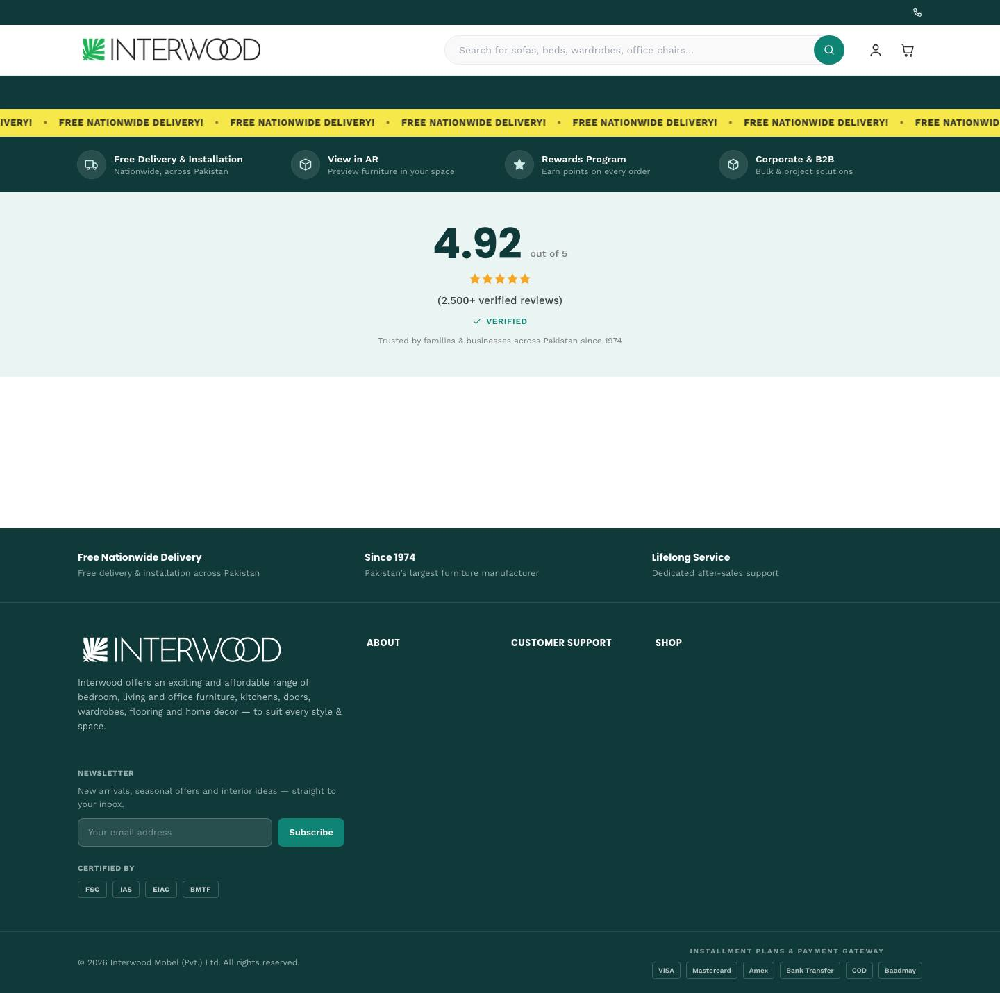
   <sub>Screenshot 1: Empty storefront home page</sub>

2. Open **All Products**: `http://localhost:3000/collections/all`.

> ✅ **Expected:** An empty-state message instead of a product grid.


   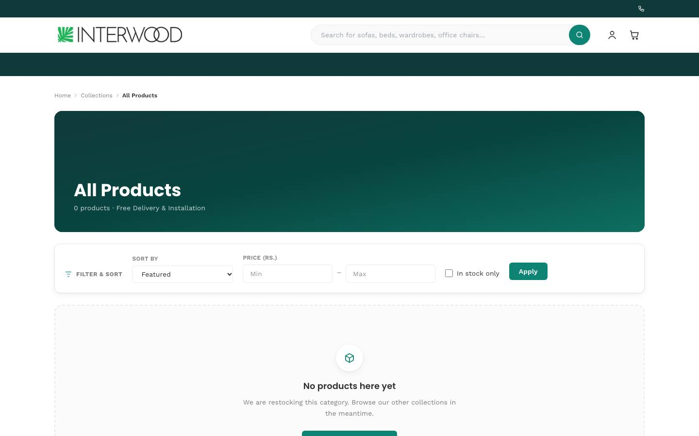
   <sub>Screenshot 2: Empty product listing</sub>


### 1.2 Admin login

1. Open the admin panel: `http://localhost:3000/admin`.

> ✅ **Expected:** You are redirected to **/admin/login**; every /admin page requires a login.


   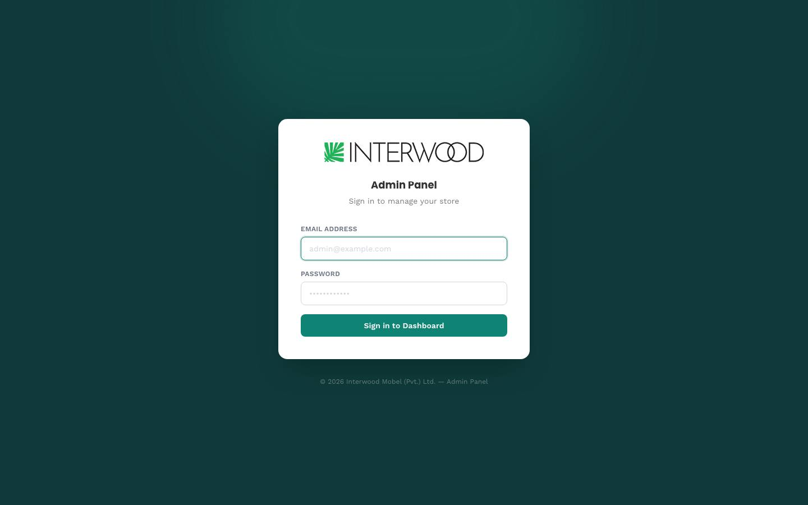
   <sub>Screenshot 3: Admin login page</sub>

2. First try a **wrong** password:

   | Field | Value |
   |---|---|
   | Email | `admin@cozyfurnitures.pk` |
   | Password | `wrong-password` |

3. Click **Sign in to Dashboard**.

> ✅ **Expected:** An "invalid email or password" error; you stay on the login page.


   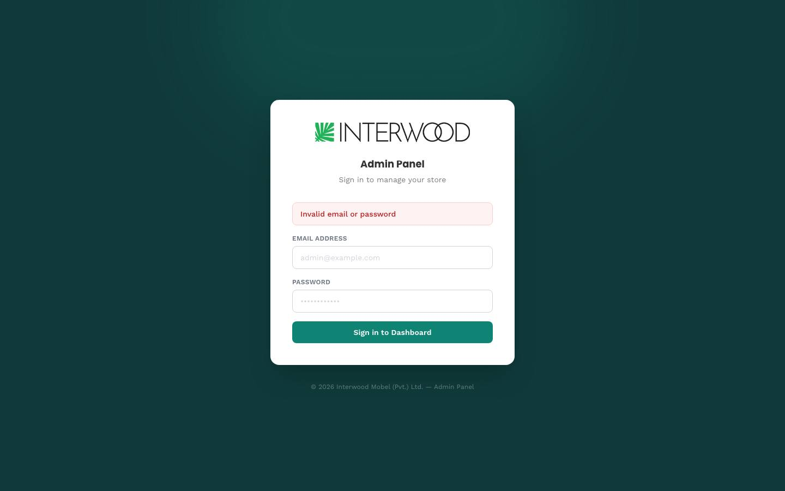
   <sub>Screenshot 4: Wrong password is rejected</sub>

4. Now sign in with the real credentials (from `.env`):

   | Field | Value |
   |---|---|
   | Email | `admin@cozyfurnitures.pk` |
   | Password | `CozyAdmin@2026` |

5. Click **Sign in to Dashboard**.

> ✅ **Expected:** The **Dashboard** opens with every counter at 0 and "No orders yet".


   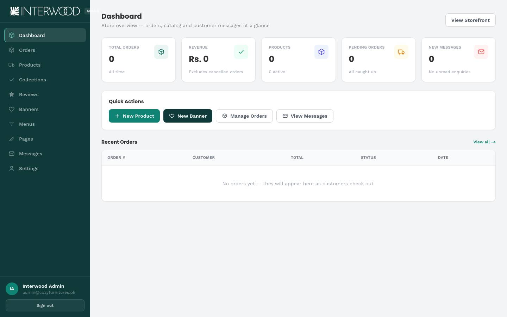
   <sub>Screenshot 5: Empty admin dashboard</sub>


## 2. Store settings

Settings hold the contact details, social links, delivery charges and rating summary used across the storefront. Changes go live immediately.

1. In the left sidebar, click **Settings**.
2. Fill in the form exactly as follows:

   | Field | Value |
   |---|---|
   | Announcement Bar (top of every page) | `Winter Sale — Flat 20% off on all sofas!` |
   | Phone | `+92-42-111-203-203` |
   | WhatsApp Number | `9242111203203` |
   | Customer Care Email | `info@interwood.pk` |
   | Complaints Email | `complaints@interwood.pk` |
   | Head Office Address | `12-KM Ferozepur Road, Lahore, Pakistan` |
   | Facebook | `https://www.facebook.com/interwood` |
   | Instagram | `https://www.instagram.com/interwood` |
   | YouTube | `https://www.youtube.com/@interwood` |
   | LinkedIn | `https://www.linkedin.com/company/interwood` |
   | Shipping Fee (Rs.) | `2500` |
   | Free Shipping Threshold (Rs.) | `100000` |
   | Overall Rating | `4.8` |
   | Rating Count Label | `1,200+ happy customers` |


> ℹ️ Delivery rule: orders **below Rs. 100,000** pay a flat **Rs. 2,500**; orders at or above it get free delivery & installation. We test both later.


   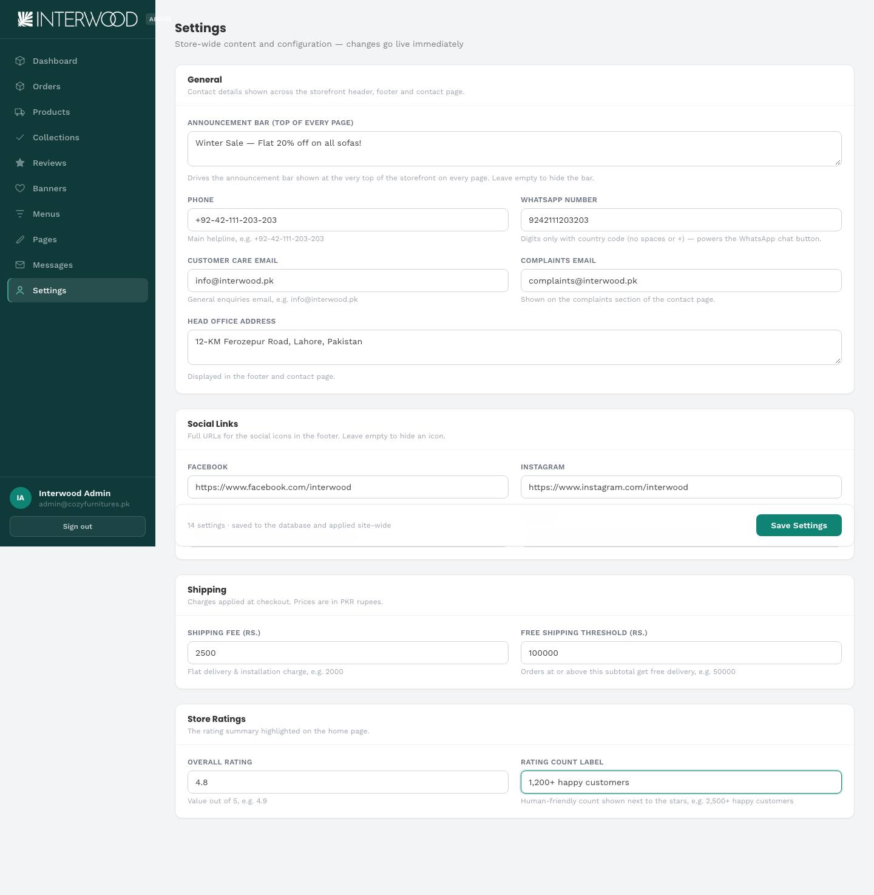
   <sub>Screenshot 6: Settings form filled in</sub>

3. Click **Save Settings**.

> ✅ **Expected:** A green "Settings saved successfully — the storefront has been updated." banner.


   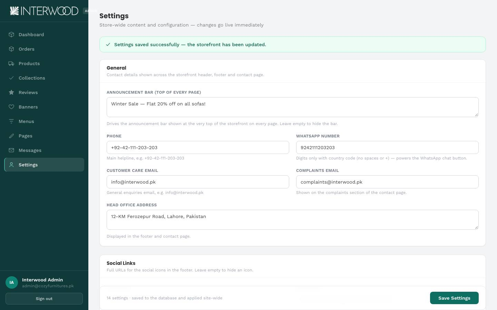
   <sub>Screenshot 7: Settings saved</sub>

4. Switch to the storefront tab and reload the home page.

> ✅ **Expected:** The announcement bar at the very top now reads "Winter Sale — Flat 20% off on all sofas!" and the phone number appears top-right. Scroll to the footer: phone, email, address and the four social icons are shown, and a green WhatsApp button floats bottom-right.


   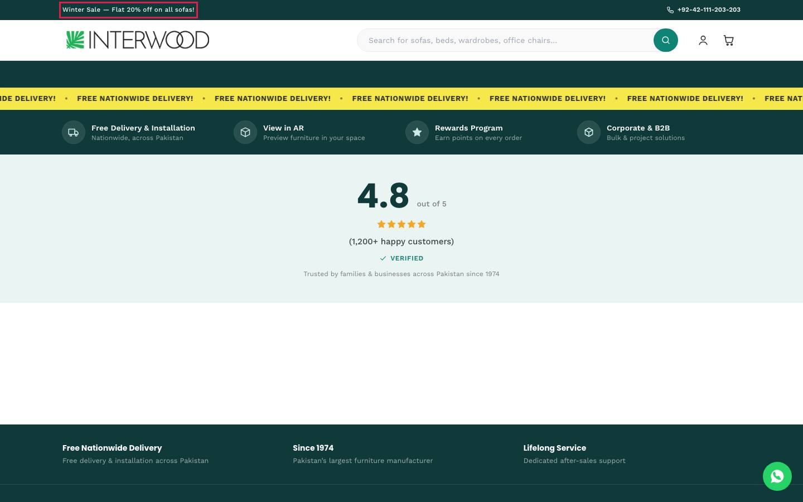
   <sub>Screenshot 8: Announcement bar and phone from settings</sub>


   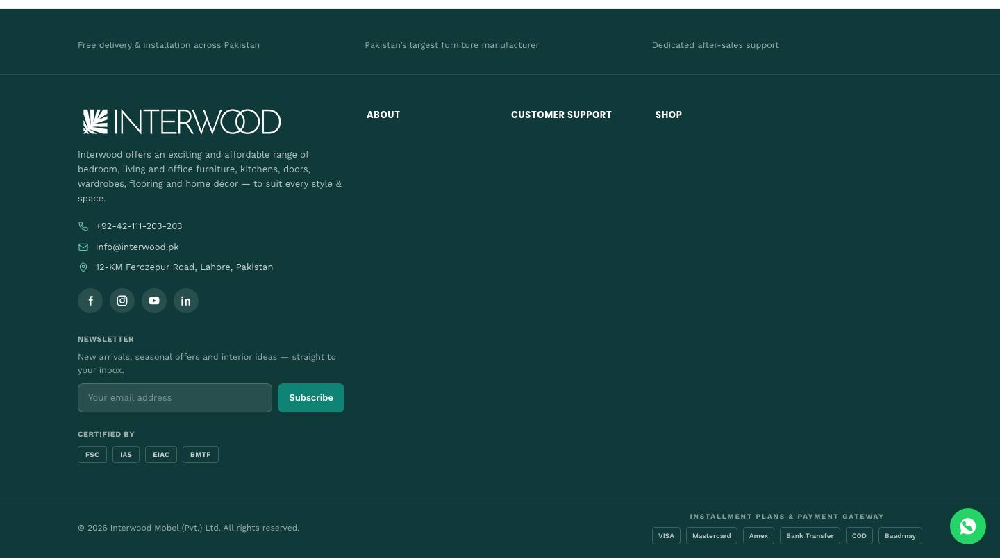
   <sub>Screenshot 9: Footer contact details and social links from settings</sub>


## 3. Collections (categories)

Collections group products. They can be nested (a **parent** department such as Living Room with **child** categories such as Sofas). "Featured on homepage" collections become the **Shop by Category** tiles and get a product row on the home page, ordered by **Position**.


### 3.1 Create the “Living Room” collection

1. In the left sidebar, click **Collections**.
2. Click **+ New collection** (top right).
3. Fill in the form exactly as follows:

   | Field | Value |
   |---|---|
   | Title | `Living Room` |
   | Handle (URL slug) | _(leave empty)_ |
   | Description | `Sofas, coffee tables and accent chairs for your lounge.` |
   | Image (URL field) | `/images/collections/living.jpg` |
   | Parent collection | `— None (top level) —` |
   | Kind | `Room` |
   | Position | `1` |
   | Show in navigation | `✓ checked` |
   | Featured on homepage | `✓ checked` |


> ℹ️ Leave **Handle** empty — it is generated from the title (“Living Room” → `living-room`). Images are paths to files that already exist under `public/images/`; the preview thumbnail updates as you type.


   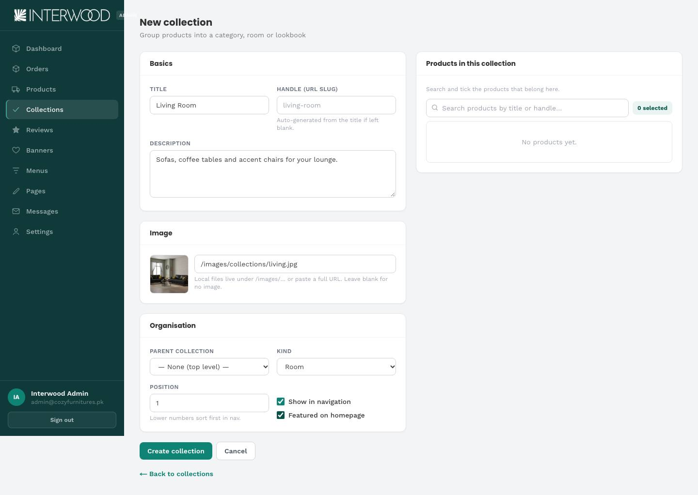
   <sub>Screenshot 10: New collection form filled in</sub>

4. Click **Create collection**.

> ✅ **Expected:** "Collection saved successfully." and you stay on the collection’s edit page.


   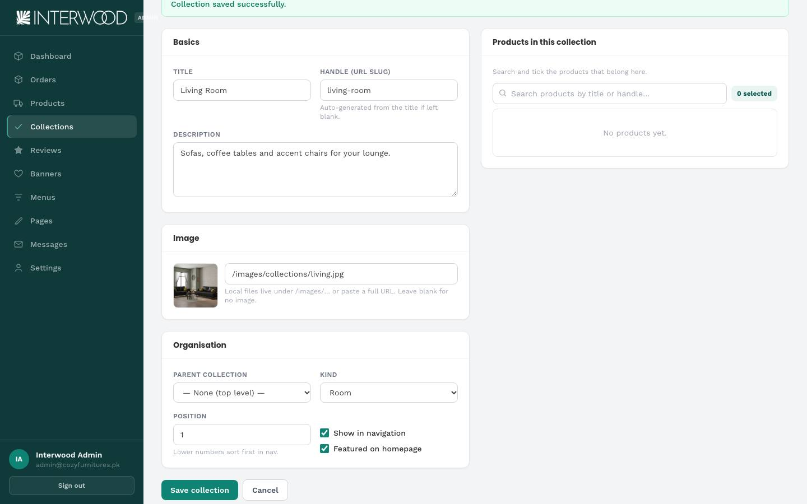
   <sub>Screenshot 11: Collection saved</sub>


### 3.2 Create the “Sofas” collection

1. In the left sidebar, click **Collections**.
2. Click **+ New collection** (top right).
3. Fill in the form exactly as follows:

   | Field | Value |
   |---|---|
   | Title | `Sofas` |
   | Handle (URL slug) | _(leave empty)_ |
   | Description | `Two, three and five seater sofas in fabric and leather.` |
   | Image (URL field) | `/images/collections/conte.webp` |
   | Parent collection | `Living Room` |
   | Kind | `Category` |
   | Position | `1` |
   | Show in navigation | `✓ checked` |
   | Featured on homepage | `✓ checked` |

4. Click **Create collection**.

### 3.3 Create the “Coffee Tables” collection

1. In the left sidebar, click **Collections**.
2. Click **+ New collection** (top right).
3. Fill in the form exactly as follows:

   | Field | Value |
   |---|---|
   | Title | `Coffee Tables` |
   | Handle (URL slug) | _(leave empty)_ |
   | Description | `Centre and coffee tables in solid wood and glass.` |
   | Image (URL field) | `/images/collections/antonin.webp` |
   | Parent collection | `Living Room` |
   | Kind | `Category` |
   | Position | `2` |
   | Show in navigation | `✓ checked` |
   | Featured on homepage | `☐ unchecked` |

4. Click **Create collection**.

### 3.4 Create the “Bedroom” collection

1. In the left sidebar, click **Collections**.
2. Click **+ New collection** (top right).
3. Fill in the form exactly as follows:

   | Field | Value |
   |---|---|
   | Title | `Bedroom` |
   | Handle (URL slug) | _(leave empty)_ |
   | Description | `Beds, bedside tables and dressing tables.` |
   | Image (URL field) | `/images/collections/bedroom.jpg` |
   | Parent collection | `— None (top level) —` |
   | Kind | `Room` |
   | Position | `2` |
   | Show in navigation | `✓ checked` |
   | Featured on homepage | `✓ checked` |

4. Click **Create collection**.

### 3.5 Create the “Beds” collection

1. In the left sidebar, click **Collections**.
2. Click **+ New collection** (top right).
3. Fill in the form exactly as follows:

   | Field | Value |
   |---|---|
   | Title | `Beds` |
   | Handle (URL slug) | _(leave empty)_ |
   | Description | `King and queen size beds crafted in solid wood.` |
   | Image (URL field) | `/images/collections/king-size-beds.jpg` |
   | Parent collection | `Bedroom` |
   | Kind | `Category` |
   | Position | `1` |
   | Show in navigation | `✓ checked` |
   | Featured on homepage | `☐ unchecked` |

4. Click **Create collection**.

### 3.6 Create the “Bedside Tables” collection

1. In the left sidebar, click **Collections**.
2. Click **+ New collection** (top right).
3. Fill in the form exactly as follows:

   | Field | Value |
   |---|---|
   | Title | `Bedside Tables` |
   | Handle (URL slug) | _(leave empty)_ |
   | Description | `Matching side tables with storage drawers.` |
   | Image (URL field) | `/images/collections/bed-side-tables.jpg` |
   | Parent collection | `Bedroom` |
   | Kind | `Category` |
   | Position | `2` |
   | Show in navigation | `✓ checked` |
   | Featured on homepage | `☐ unchecked` |

4. Click **Create collection**.

### 3.7 Create the “Office Chairs” collection

1. In the left sidebar, click **Collections**.
2. Click **+ New collection** (top right).
3. Fill in the form exactly as follows:

   | Field | Value |
   |---|---|
   | Title | `Office Chairs` |
   | Handle (URL slug) | _(leave empty)_ |
   | Description | `Ergonomic manager, executive and visitor chairs.` |
   | Image (URL field) | `/images/collections/office-chairs.webp` |
   | Parent collection | `— None (top level) —` |
   | Kind | `Category` |
   | Position | `3` |
   | Show in navigation | `✓ checked` |
   | Featured on homepage | `✓ checked` |

4. Click **Create collection**.

### 3.8 Create the “Sale” collection

1. In the left sidebar, click **Collections**.
2. Click **+ New collection** (top right).
3. Fill in the form exactly as follows:

   | Field | Value |
   |---|---|
   | Title | `Sale` |
   | Handle (URL slug) | _(leave empty)_ |
   | Description | `Limited-time offers across the range.` |
   | Image (URL field) | `/images/collections/furniture.jpg` |
   | Parent collection | `— None (top level) —` |
   | Kind | `Helper` |
   | Position | `9` |
   | Show in navigation | `☐ unchecked` |
   | Featured on homepage | `☐ unchecked` |

4. Click **Create collection**.

### 3.9 Check the collection list

1. In the left sidebar, click **Collections**.

> ✅ **Expected:** **8 collections**. Children show their parent (Sofas → Living Room). “Sale” is not in the navigation. Product counts are 0 for now.


   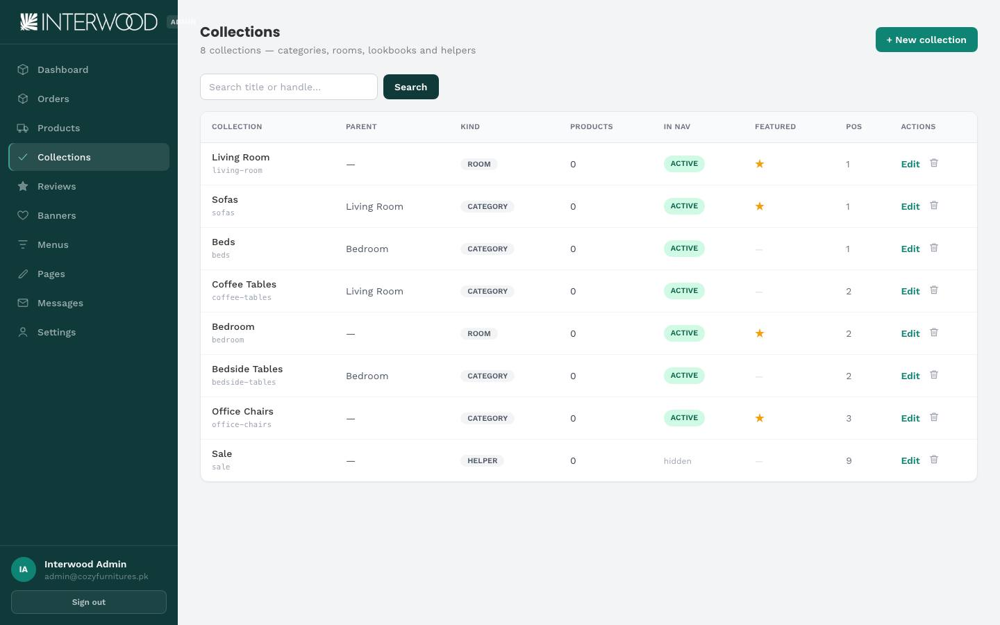
   <sub>Screenshot 12: Collections list</sub>


## 4. Products

Each product has basics, an HTML description, one or more **variants** (each with its own price, compare-at price, SKU and stock), **images** and the **collections** it belongs to. Prices are whole rupees. A variant with **inventory 0** is sold as **Made to Order** (still purchasable). **Hot product** puts it in the home page “Hot Selling Products” row. **Draft** products are hidden from the store.


### 4.1 What the browser checks before saving

1. In the left sidebar, click **Products**.
2. Click **+ New product**.
3. Type only a title and leave the variant price empty:

   | Field | Value |
   |---|---|
   | Title | `Test Without Price` |

4. Click **Create product**.

> ✅ **Expected:** The form is **not** submitted: the browser highlights the empty **Price (PKR)** box ("Please fill out this field") and everything you typed is kept. Negative or non-numeric prices (e.g. `-500`) are blocked the same way.


   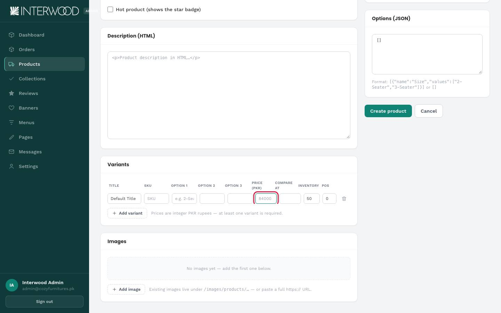
   <sub>Screenshot 13: Missing price blocked by the browser</sub>


### 4.2 Create “Alexa Sofa Chair”

1. In the left sidebar, click **Products**.
2. Click **+ New product**.
3. **Basics** (the Handle fills itself from the title):

   | Field | Value |
   |---|---|
   | Title | `Alexa Sofa Chair` |
   | Status | `Active (visible in store)` |
   | Product type | `Sofa Chair` |
   | Tags | `living, accent, velvet` |
   | Hot product (shows the star badge) | `✓ checked` |
   | Description (HTML) | `<p>A plush accent chair with solid wood legs.</p><br><ul><li>Fabric: premium velvet</li><li>Frame: kiln-dried wood</li><li>Size: 30" W x 32" D x 34" H</li></ul>` |

4. **Variants** — one row is already there:

   | # | Title | SKU | Option 1 | Price (PKR) | Compare at | Inventory |
   |---|---|---|---|---|---|---|
   | 1 | `Default Title` | `ALX-01` | — | `45000` | `52000` | `12` |

5. **Images** — click **+ Add image** once per row, then fill the source path and alt text:

   | # | Source | Alt text |
   |---|---|---|
   | 1 | `/images/products/alexa-sofa-chair-1.jpg` | `Alexa Sofa Chair front` |
   | 2 | `/images/products/alexa-sofa-chair-2.jpg` | `Alexa Sofa Chair side` |

6. **Collections** (right column) — tick: **Living Room**, **Sofas**, **Sale**.
7. Click **Create product**.

> ✅ **Expected:** "Product saved successfully." — you are now on the product’s edit page.


   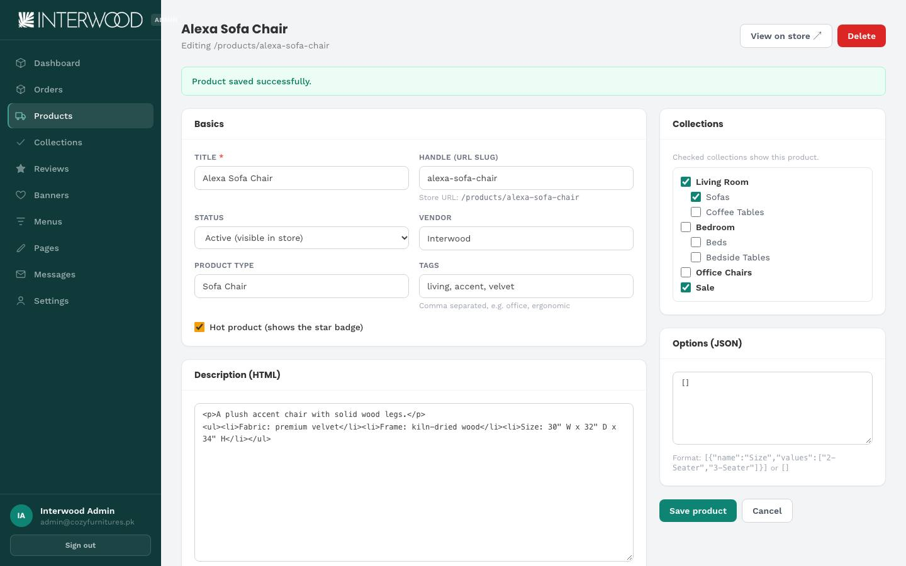
   <sub>Screenshot 14: Product saved</sub>


### 4.3 Create “Antonin Sofa”

1. In the left sidebar, click **Products**.
2. Click **+ New product**.
3. **Basics** (the Handle fills itself from the title):

   | Field | Value |
   |---|---|
   | Title | `Antonin Sofa` |
   | Status | `Active (visible in store)` |
   | Product type | `Sofa` |
   | Tags | `living, sofa` |
   | Hot product (shows the star badge) | `✓ checked` |
   | Description (HTML) | `<p>A modern sofa with deep seats and tapered brass-finish legs, available as a 3-seater or 2-seater.</p>` |
   | Options (JSON) — right column | `[{"name":"Size","values":["3-Seater","2-Seater"]}]` |

4. **Variants** — the first row already exists; click **+ Add variant** for each extra row:

   | # | Title | SKU | Option 1 | Price (PKR) | Compare at | Inventory |
   |---|---|---|---|---|---|---|
   | 1 | `3-Seater` | `ANT-3` | `3-Seater` | `120000` | `140000` | `5` |
   | 2 | `2-Seater` | `ANT-2` | `2-Seater` | `85000` | — | `8` |

5. **Images** — click **+ Add image** once per row, then fill the source path and alt text:

   | # | Source | Alt text |
   |---|---|---|
   | 1 | `/images/products/antonin-sofa-1.jpg` | `Antonin Sofa` |
   | 2 | `/images/products/antonin-sofa-2.webp` | `Antonin Sofa detail` |
   | 3 | `/images/products/antonin-sofa-3.webp` | `Antonin Sofa side` |

6. **Collections** (right column) — tick: **Living Room**, **Sofas**.

> ℹ️ A product with options (here **Size**) needs the Options JSON plus one variant per value, with the value in **Option 1**. The storefront shows these as buttons.


   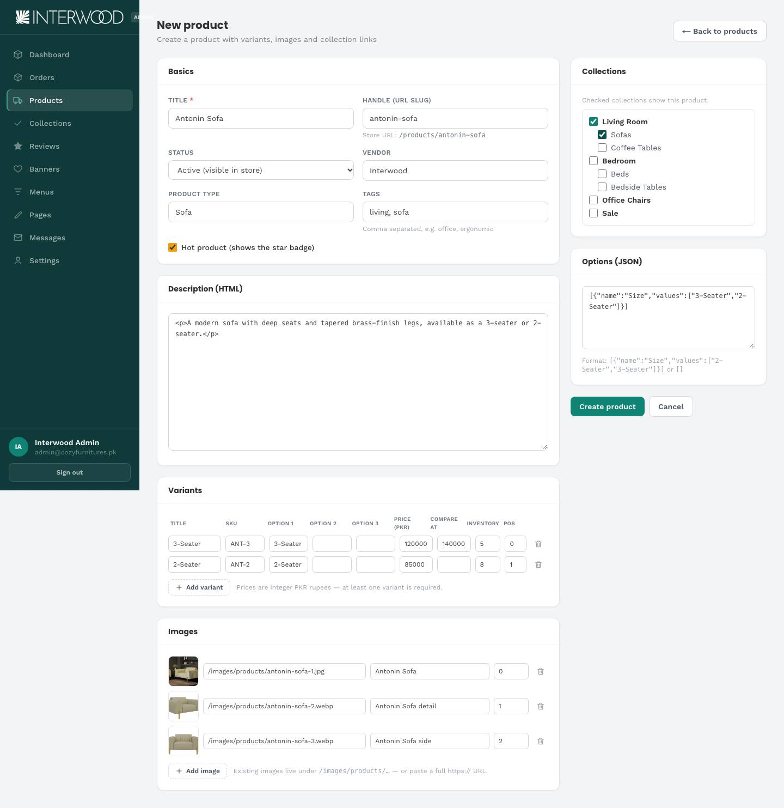
   <sub>Screenshot 15: Product form with two variants, images and collections</sub>

7. Click **Create product**.

### 4.4 Create “Antonin Center Table”

1. In the left sidebar, click **Products**.
2. Click **+ New product**.
3. **Basics** (the Handle fills itself from the title):

   | Field | Value |
   |---|---|
   | Title | `Antonin Center Table` |
   | Status | `Active (visible in store)` |
   | Product type | `Center Table` |
   | Tags | `living, table` |
   | Hot product (shows the star badge) | `☐ unchecked` |
   | Description (HTML) | `<p>Solid wood centre table that matches the Antonin sofa range.</p>` |

4. **Variants** — one row is already there:

   | # | Title | SKU | Option 1 | Price (PKR) | Compare at | Inventory |
   |---|---|---|---|---|---|---|
   | 1 | `Default Title` | `ANT-CT` | — | `32000` | — | `10` |

5. **Images** — click **+ Add image** once per row, then fill the source path and alt text:

   | # | Source | Alt text |
   |---|---|---|
   | 1 | `/images/products/antonin-center-table-1.jpg` | `Antonin Center Table` |
   | 2 | `/images/products/antonin-center-table-2.jpg` | `Antonin Center Table top` |

6. **Collections** (right column) — tick: **Living Room**, **Coffee Tables**.
7. Click **Create product**.

### 4.5 Create “Alpen King Size Bed”

1. In the left sidebar, click **Products**.
2. Click **+ New product**.
3. **Basics** (the Handle fills itself from the title):

   | Field | Value |
   |---|---|
   | Title | `Alpen King Size Bed` |
   | Status | `Active (visible in store)` |
   | Product type | `Bed` |
   | Tags | `bedroom, bed, king` |
   | Hot product (shows the star badge) | `✓ checked` |
   | Description (HTML) | `<p>Solid wood king size bed with an upholstered headboard.</p><br><p><strong>Mattress size:</strong> 78" x 72"</p>` |

4. **Variants** — one row is already there:

   | # | Title | SKU | Option 1 | Price (PKR) | Compare at | Inventory |
   |---|---|---|---|---|---|---|
   | 1 | `Default Title` | `ALP-K` | — | `150000` | `175000` | `3` |

5. **Images** — click **+ Add image** once per row, then fill the source path and alt text:

   | # | Source | Alt text |
   |---|---|---|
   | 1 | `/images/products/alpen-bed-1.jpg` | `Alpen King Size Bed` |
   | 2 | `/images/products/alpen-bed-2.png` | `Alpen bed headboard` |

6. **Collections** (right column) — tick: **Bedroom**, **Beds**.
7. Click **Create product**.

### 4.6 Create “Aura Bedside Table”

1. In the left sidebar, click **Products**.
2. Click **+ New product**.
3. **Basics** (the Handle fills itself from the title):

   | Field | Value |
   |---|---|
   | Title | `Aura Bedside Table` |
   | Status | `Active (visible in store)` |
   | Product type | `Bedside Table` |
   | Tags | `bedroom, storage` |
   | Hot product (shows the star badge) | `☐ unchecked` |
   | Description (HTML) | `<p>Two-drawer bedside table with soft-close runners.</p>` |

4. **Variants** — one row is already there:

   | # | Title | SKU | Option 1 | Price (PKR) | Compare at | Inventory |
   |---|---|---|---|---|---|---|
   | 1 | `Default Title` | `AURA-BT` | — | `18500` | — | `20` |

5. **Images** — click **+ Add image** once per row, then fill the source path and alt text:

   | # | Source | Alt text |
   |---|---|---|
   | 1 | `/images/products/aura-bedside-table-1.jpg` | `Aura Bedside Table` |
   | 2 | `/images/products/aura-bedside-table-2.jpg` | `Aura Bedside Table open` |

6. **Collections** (right column) — tick: **Bedroom**, **Bedside Tables**.
7. Click **Create product**.

### 4.7 Create “Aeon Manager Chair”

1. In the left sidebar, click **Products**.
2. Click **+ New product**.
3. **Basics** (the Handle fills itself from the title):

   | Field | Value |
   |---|---|
   | Title | `Aeon Manager Chair` |
   | Status | `Active (visible in store)` |
   | Product type | `Chair` |
   | Tags | `office, ergonomic` |
   | Hot product (shows the star badge) | `☐ unchecked` |
   | Description (HTML) | `<p>High-back manager chair with lumbar support and tilt lock.</p>` |

4. **Variants** — one row is already there:

   | # | Title | SKU | Option 1 | Price (PKR) | Compare at | Inventory |
   |---|---|---|---|---|---|---|
   | 1 | `Black` | `AEON-BLK` | — | `38500` | — | `0` |

5. **Images** — click **+ Add image** once per row, then fill the source path and alt text:

   | # | Source | Alt text |
   |---|---|---|
   | 1 | `/images/products/aeon-manager-chair-black-1.jpg` | `Aeon Manager Chair` |

6. **Collections** (right column) — tick: **Office Chairs**.
7. Click **Create product**.

### 4.8 Create “Apex Manager Chair”

1. In the left sidebar, click **Products**.
2. Click **+ New product**.
3. **Basics** (the Handle fills itself from the title):

   | Field | Value |
   |---|---|
   | Title | `Apex Manager Chair` |
   | Status | `Active (visible in store)` |
   | Product type | `Chair` |
   | Tags | `office, ergonomic, headrest` |
   | Hot product (shows the star badge) | `☐ unchecked` |
   | Description (HTML) | `<p>Mesh-back manager chair, available with or without a headrest.</p>` |
   | Options (JSON) — right column | `[{"name":"Headrest","values":["With Headrest","Without Headrest"]}]` |

4. **Variants** — the first row already exists; click **+ Add variant** for each extra row:

   | # | Title | SKU | Option 1 | Price (PKR) | Compare at | Inventory |
   |---|---|---|---|---|---|---|
   | 1 | `With Headrest` | `APX-HR` | `With Headrest` | `42000` | `48000` | `6` |
   | 2 | `Without Headrest` | `APX-NO` | `Without Headrest` | `37000` | `42000` | `9` |

5. **Images** — click **+ Add image** once per row, then fill the source path and alt text:

   | # | Source | Alt text |
   |---|---|---|
   | 1 | `/images/products/apex-manager-chair-with-headrest-1.jpg` | `Apex chair with headrest` |
   | 2 | `/images/products/apex-manager-chair-without-headrest-1.jpg` | `Apex chair without headrest` |

6. **Collections** (right column) — tick: **Office Chairs**.
7. Click **Create product**.

### 4.9 Create “Prototype Dining Table” (draft)

1. In the left sidebar, click **Products**.
2. Click **+ New product**.
3. **Basics** (the Handle fills itself from the title):

   | Field | Value |
   |---|---|
   | Title | `Prototype Dining Table` |
   | Status | `Draft` |
   | Product type | `Dining Table` |
   | Tags | `draft` |
   | Hot product (shows the star badge) | `☐ unchecked` |
   | Description (HTML) | `<p>Not ready for sale yet.</p>` |

4. **Variants** — one row is already there:

   | # | Title | SKU | Option 1 | Price (PKR) | Compare at | Inventory |
   |---|---|---|---|---|---|---|
   | 1 | `Default Title` | `PROTO-DT` | — | `99000` | — | `1` |

5. **Images** — click **+ Add image** once per row, then fill the source path and alt text:

   | # | Source | Alt text |
   |---|---|---|
   | 1 | `/images/products/arbour-dining-table-set-1.jpg` | `Prototype dining table` |

6. **Collections** (right column) — tick: **Living Room**.
7. Click **Create product**.

### 4.10 Check the product list

1. In the left sidebar, click **Products**.

> ✅ **Expected:** **8 products**. Hot products have a filled star, the Prototype Dining Table is **DRAFT**, and products with several variants show a price range (Antonin Sofa: Rs. 85,000 – Rs. 120,000).


   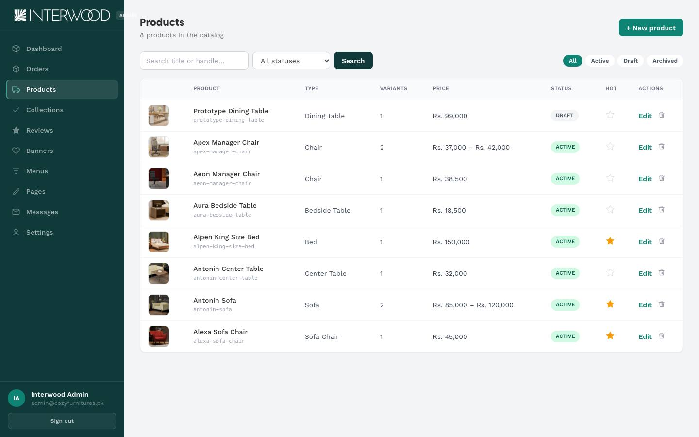
   <sub>Screenshot 16: Product list</sub>


### 4.11 Edit a product

1. On the **Aura Bedside Table** row, click **Edit**.
2. Put it on offer:

   | Field | Value |
   |---|---|
   | Variant 1 → Price (PKR) | `17500` |
   | Variant 1 → Compare at | `19500` |

3. Click **Save product**.

> ✅ **Expected:** Saved; after a reload the price is 17500 and compare-at 19500. The storefront will show **Rs. 17,500**, a struck-through **Rs. 19,500** and a **-10% OFF** badge.


### 4.12 Product counts on collections

1. In the left sidebar, click **Collections**.

> ✅ **Expected:** Living Room 4 (incl. the draft), Sofas 2, Coffee Tables 1, Bedroom 2, Beds 1, Bedside Tables 1, Office Chairs 2, Sale 1.


   
   <sub>Screenshot 17: Collections with product counts</sub>


## 5. Banners

Banners appear on the home page. **Home — Hero slider** banners rotate at the top; **Promo strip 1** sits under the trust strip and **Promo strip 2** under the rating banner. Inactive banners are hidden.


### 5.1 Banner “Winter Living Sale”

1. In the left sidebar, click **Banners**.
2. Use the **Add a banner** form at the top of the page:

   | Field | Value |
   |---|---|
   | Headline | `Winter Living Sale` |
   | Subtitle | `Up to 20% off sofas and accent chairs` |
   | CTA label | `Shop Living Room` |
   | CTA link | `/collections/living-room` |
   | Desktop image URL | `/images/collections/living.jpg` |
   | Mobile image URL | `/images/products/antonin-sofa-1.jpg` |
   | Location | `Home — Hero slider` |
   | Position | `0` |
   | Text colour | `#ffffff (default, leave as is)` |
   | Overlay | `45` |
   | Active (visible on the storefront) | `✓ checked` |


> ℹ️ **Overlay** darkens the left side of the image behind the white text (0–90%). Use a higher value on light photos, otherwise the headline is hard to read.


   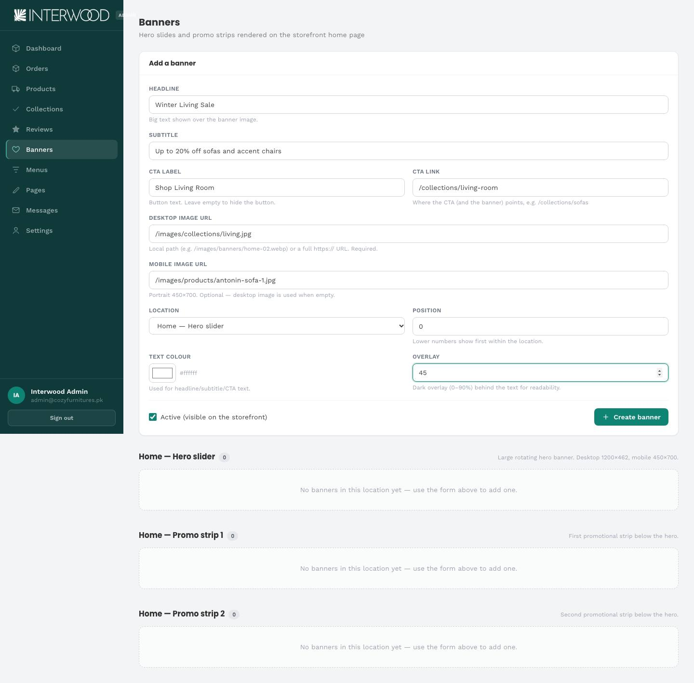
   <sub>Screenshot 18: Add a banner form filled in</sub>

3. Click **Create banner**.

### 5.2 Banner “Sleep Like Royalty”

1. In the left sidebar, click **Banners**.
2. Use the **Add a banner** form at the top of the page:

   | Field | Value |
   |---|---|
   | Headline | `Sleep Like Royalty` |
   | Subtitle | `King size beds, crafted in solid wood` |
   | CTA label | `Shop Bedroom` |
   | CTA link | `/collections/bedroom` |
   | Desktop image URL | `/images/collections/bedroom.jpg` |
   | Mobile image URL | _(leave empty)_ |
   | Location | `Home — Hero slider` |
   | Position | `1` |
   | Text colour | `#ffffff (default, leave as is)` |
   | Overlay | `45` |
   | Active (visible on the storefront) | `✓ checked` |

3. Click **Create banner**.

### 5.3 Banner “Coming Soon: Dining” (inactive)

1. In the left sidebar, click **Banners**.
2. Use the **Add a banner** form at the top of the page:

   | Field | Value |
   |---|---|
   | Headline | `Coming Soon: Dining` |
   | Subtitle | `Hidden until it is activated` |
   | CTA label | `Preview` |
   | CTA link | `/` |
   | Desktop image URL | `/images/collections/dining.jpg` |
   | Mobile image URL | _(leave empty)_ |
   | Location | `Home — Hero slider` |
   | Position | `2` |
   | Text colour | `#ffffff (default, leave as is)` |
   | Overlay | `20` |
   | Active (visible on the storefront) | `☐ unchecked` |

3. Click **Create banner**.

### 5.4 Banner “Office Upgrade”

1. In the left sidebar, click **Banners**.
2. Use the **Add a banner** form at the top of the page:

   | Field | Value |
   |---|---|
   | Headline | `Office Upgrade` |
   | Subtitle | `Ergonomic chairs for long workdays` |
   | CTA label | `Shop Office Chairs` |
   | CTA link | `/collections/office-chairs` |
   | Desktop image URL | `/images/products/apex-manager-chair-with-headrest-1.jpg` |
   | Mobile image URL | _(leave empty)_ |
   | Location | `Home — Promo strip 1` |
   | Position | `0` |
   | Text colour | `#ffffff (default, leave as is)` |
   | Overlay | `50` |
   | Active (visible on the storefront) | `✓ checked` |

3. Click **Create banner**.

### 5.5 Banner “Free Delivery Over Rs. 100,000”

1. In the left sidebar, click **Banners**.
2. Use the **Add a banner** form at the top of the page:

   | Field | Value |
   |---|---|
   | Headline | `Free Delivery Over Rs. 100,000` |
   | Subtitle | `Delivery & installation included on bigger orders` |
   | CTA label | `Browse All` |
   | CTA link | `/collections/all` |
   | Desktop image URL | `/images/collections/furniture.jpg` |
   | Mobile image URL | _(leave empty)_ |
   | Location | `Home — Promo strip 2` |
   | Position | `0` |
   | Text colour | `#ffffff (default, leave as is)` |
   | Overlay | `65` |
   | Active (visible on the storefront) | `✓ checked` |

3. Click **Create banner**.

> ✅ **Expected:** "Banner saved. Storefront updated." after each. Below the form, banners are grouped by location: **Hero slider (3)** with one marked **Inactive**, **Promo strip 1 (1)**, **Promo strip 2 (1)**. Each has Deactivate/Delete buttons and an inline edit form.


   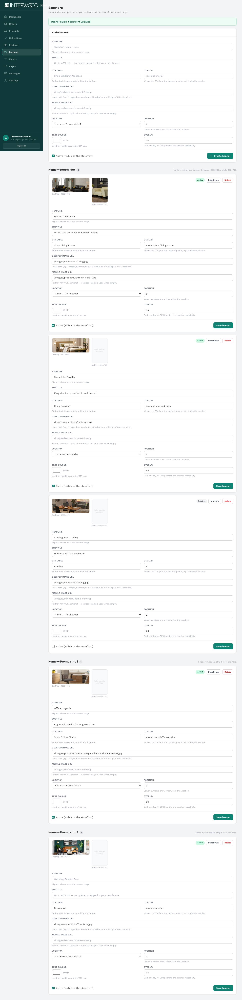
   <sub>Screenshot 19: Banners grouped by location</sub>


## 6. Menus

Five menus: **Main navigation** (the dark bar under the logo; items can have one level of children that open as a dropdown), **Top bar** (small links top-right) and **Footer — column 1/2/3**. Pick the menu with the pill tabs, then add links with the form.


### 6.1 Main navigation

1. In the left sidebar, click **Menus**.
2. Click the **Main navigation** tab.
3. Add each link below with the **Add a link** form (fill the row, click **+ Add item**, repeat). Leave Badge empty and Parent as "— Top level —" unless listed:

   | Label | Link | Badge | Position | Parent | Enabled |
   |---|---|---|---|---|---|
   | `Living Room` | `/collections/living-room` | — | `0` | — Top level — | ✓ |
   | `Sofas` | `/collections/sofas` | — | `0` | Living Room | ✓ |
   | `Coffee Tables` | `/collections/coffee-tables` | — | `1` | Living Room | ✓ |
   | `Bedroom` | `/collections/bedroom` | — | `1` | — Top level — | ✓ |
   | `Beds` | `/collections/beds` | — | `0` | Bedroom | ✓ |
   | `Bedside Tables` | `/collections/bedside-tables` | — | `1` | Bedroom | ✓ |
   | `Office` | `/collections/office-chairs` | `NEW` | `2` | — Top level — | ✓ |
   | `All Products` | `/collections/all` | — | `3` | — Top level — | ✓ |
   | `Sale` | `/collections/sale` | `SALE` | `4` | — Top level — | ✓ |
   | `Clearance` | `/collections/sale` | — | `5` | — Top level — | ☐ **unchecked** |


> ℹ️ “Clearance” is added **disabled** on purpose — it must not appear on the storefront.


   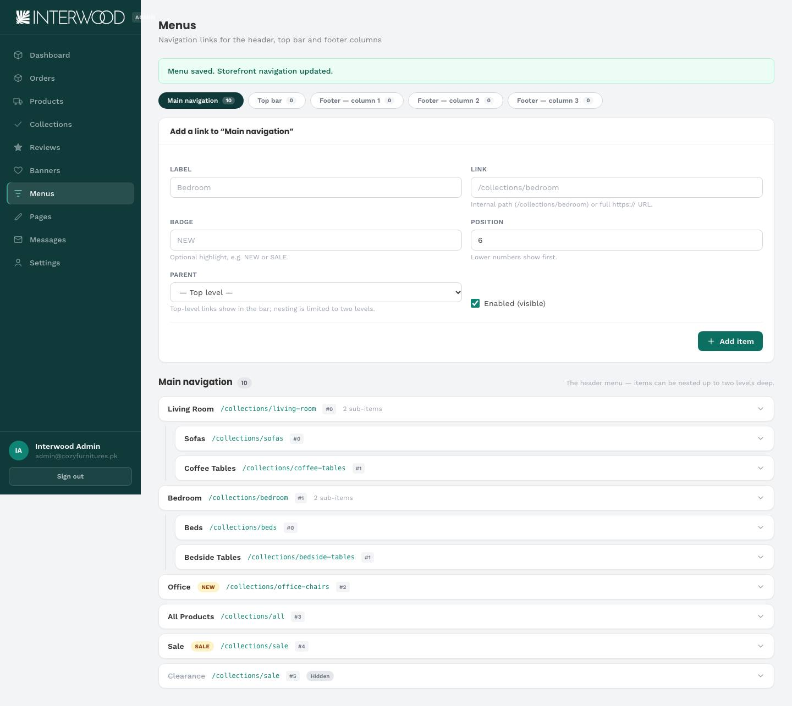
   <sub>Screenshot 20: Main navigation menu tree</sub>


### 6.2 Top bar

1. In the left sidebar, click **Menus**.
2. Click the **Top bar** tab.
3. Add each link below with the **Add a link** form (fill the row, click **+ Add item**, repeat). Leave Badge empty and Parent as "— Top level —" unless listed:

   | Label | Link | Badge | Position | Parent | Enabled |
   |---|---|---|---|---|---|
   | `Track Order` | `/track` | — | `0` | — Top level — | ✓ |
   | `Contact Us` | `/pages/contact` | — | `1` | — Top level — | ✓ |


### 6.3 Footer column 1 (“About”)

1. In the left sidebar, click **Menus**.
2. Click the **Footer — column 1** tab.
3. Add each link below with the **Add a link** form (fill the row, click **+ Add item**, repeat). Leave Badge empty and Parent as "— Top level —" unless listed:

   | Label | Link | Badge | Position | Parent | Enabled |
   |---|---|---|---|---|---|
   | `About Us` | `/pages/about-us` | — | `0` | — Top level — | ✓ |
   | `Blog` | `/blogs` | — | `1` | — Top level — | ✓ |
   | `Contact Us` | `/pages/contact` | — | `2` | — Top level — | ✓ |


### 6.4 Footer column 2 (“Customer Support”)

1. In the left sidebar, click **Menus**.
2. Click the **Footer — column 2** tab.
3. Add each link below with the **Add a link** form (fill the row, click **+ Add item**, repeat). Leave Badge empty and Parent as "— Top level —" unless listed:

   | Label | Link | Badge | Position | Parent | Enabled |
   |---|---|---|---|---|---|
   | `FAQs` | `/pages/faqs` | — | `0` | — Top level — | ✓ |
   | `Shipping & Delivery` | `/pages/shipping-delivery` | — | `1` | — Top level — | ✓ |
   | `Returns & Exchanges` | `/pages/returns-exchanges` | — | `2` | — Top level — | ✓ |
   | `Privacy Policy` | `/pages/privacy-policy` | — | `3` | — Top level — | ✓ |
   | `Terms & Conditions` | `/pages/terms-conditions` | — | `4` | — Top level — | ✓ |
   | `Track Your Order` | `/track` | — | `5` | — Top level — | ✓ |


### 6.5 Footer column 3 (“Shop”)

1. In the left sidebar, click **Menus**.
2. Click the **Footer — column 3** tab.
3. Add each link below with the **Add a link** form (fill the row, click **+ Add item**, repeat). Leave Badge empty and Parent as "— Top level —" unless listed:

   | Label | Link | Badge | Position | Parent | Enabled |
   |---|---|---|---|---|---|
   | `Sofas` | `/collections/sofas` | — | `0` | — Top level — | ✓ |
   | `Beds` | `/collections/beds` | — | `1` | — Top level — | ✓ |
   | `Office Chairs` | `/collections/office-chairs` | — | `2` | — Top level — | ✓ |
   | `Sale` | `/collections/sale` | — | `3` | — Top level — | ✓ |


## 7. Pages and blog posts

Pages are rich HTML content served at `/pages/<handle>`. The page with handle **contact** automatically gets the contact form underneath. Ticking **Blog post** publishes it in the blog at `/blogs/news/<handle>` instead. Unpublished pages return 404.


### 7.1 Page “About Us”

1. In the left sidebar, click **Pages**.
2. Click **New page**.
3. Fill in the form exactly as follows:

   | Field | Value |
   |---|---|
   | Title | `About Us` |
   | Handle | `about-us` |
   | Body (HTML) | `<h2>Crafted in Pakistan since 1974</h2><br><p>Interwood designs and manufactures furniture for homes and offices across Pakistan.</p><br><h2>Our promise</h2><br><ul><li>Solid, kiln-dried wood</li><li>Free delivery &amp; installation on orders over Rs. 100,000</li><li>1-year manufacturing warranty</li></ul>` |
   | SEO title | `About Interwood — Pakistan’s Largest Furniture Manufacturer` |
   | SEO description | `Our story: crafting furniture in Pakistan since 1974.` |
   | Published | `✓ checked` |
   | Blog post | `☐ unchecked` |


   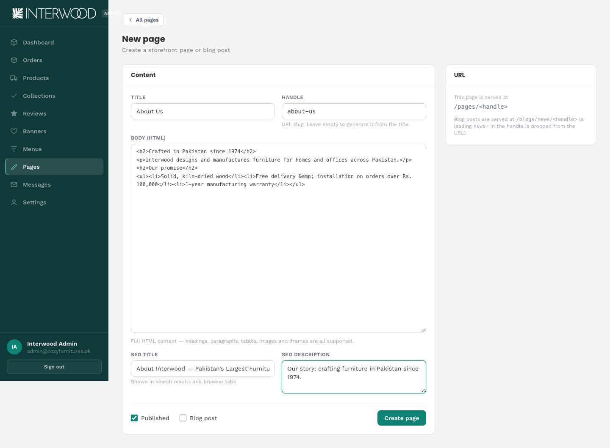
   <sub>Screenshot 21: New page form filled in</sub>

4. Click **Create page**.

> ✅ **Expected:** The page is created and its edit screen shows the public URL (here `/pages/about-us`).


   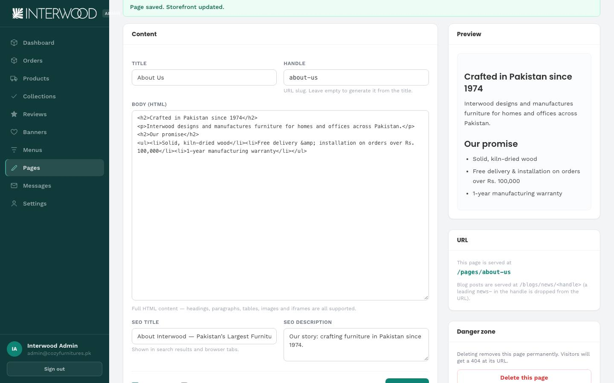
   <sub>Screenshot 22: Page saved with its public URL</sub>


### 7.2 Page “Contact”

1. In the left sidebar, click **Pages**.
2. Click **New page**.
3. Fill in the form exactly as follows:

   | Field | Value |
   |---|---|
   | Title | `Contact` |
   | Handle | `contact` |
   | Body (HTML) | `<p>Call <strong>+92-42-111-203-203</strong> (Mon–Sat, 9am–9pm) or send us a message using the form below.</p>` |
   | SEO title | _(leave empty)_ |
   | SEO description | _(leave empty)_ |
   | Published | `✓ checked` |
   | Blog post | `☐ unchecked` |

4. Click **Create page**.

### 7.3 Page “Privacy Policy”

1. In the left sidebar, click **Pages**.
2. Click **New page**.
3. Fill in the form exactly as follows:

   | Field | Value |
   |---|---|
   | Title | `Privacy Policy` |
   | Handle | _(leave empty)_ |
   | Body (HTML) | `<h2>Information we collect</h2><br><p>We collect your name, phone number, email and delivery address to process your order.</p><br><h2>How we use it</h2><br><p>Only to confirm, deliver and support your order. We never sell your data.</p><br><h2>Contact</h2><br><p>Questions? Email info@interwood.pk.</p>` |
   | SEO title | _(leave empty)_ |
   | SEO description | _(leave empty)_ |
   | Published | `✓ checked` |
   | Blog post | `☐ unchecked` |

4. Click **Create page**.

### 7.4 Page “Terms & Conditions”

1. In the left sidebar, click **Pages**.
2. Click **New page**.
3. Fill in the form exactly as follows:

   | Field | Value |
   |---|---|
   | Title | `Terms & Conditions` |
   | Handle | `terms-conditions` |
   | Body (HTML) | `<h2>Orders</h2><br><p>All orders are confirmed by phone before production.</p><br><h2>Pricing</h2><br><p>Prices are in Pakistani Rupees and include sales tax.</p>` |
   | SEO title | _(leave empty)_ |
   | SEO description | _(leave empty)_ |
   | Published | `✓ checked` |
   | Blog post | `☐ unchecked` |

4. Click **Create page**.

### 7.5 Page “Shipping & Delivery”

1. In the left sidebar, click **Pages**.
2. Click **New page**.
3. Fill in the form exactly as follows:

   | Field | Value |
   |---|---|
   | Title | `Shipping & Delivery` |
   | Handle | `shipping-delivery` |
   | Body (HTML) | `<h2>Delivery charges</h2><br><p>Free delivery &amp; installation on orders of Rs. 100,000 or more. A flat Rs. 2,500 applies below that.</p><br><h2>Timelines</h2><br><p>Ready-to-ship items: 5–7 working days. Made-to-order items: 3–4 weeks.</p>` |
   | SEO title | _(leave empty)_ |
   | SEO description | _(leave empty)_ |
   | Published | `✓ checked` |
   | Blog post | `☐ unchecked` |

4. Click **Create page**.

### 7.6 Page “Returns & Exchanges”

1. In the left sidebar, click **Pages**.
2. Click **New page**.
3. Fill in the form exactly as follows:

   | Field | Value |
   |---|---|
   | Title | `Returns & Exchanges` |
   | Handle | `returns-exchanges` |
   | Body (HTML) | `<p>Report any damage within 48 hours of delivery and we will repair or replace the item.</p>` |
   | SEO title | _(leave empty)_ |
   | SEO description | _(leave empty)_ |
   | Published | `✓ checked` |
   | Blog post | `☐ unchecked` |

4. Click **Create page**.

### 7.7 Page “FAQs”

1. In the left sidebar, click **Pages**.
2. Click **New page**.
3. Fill in the form exactly as follows:

   | Field | Value |
   |---|---|
   | Title | `FAQs` |
   | Handle | `faqs` |
   | Body (HTML) | `<h2>Do you deliver nationwide?</h2><br><p>Yes, to every city in Pakistan.</p><br><h2>Can I pay cash on delivery?</h2><br><p>Yes — COD, bank transfer, card and installments are available.</p>` |
   | SEO title | _(leave empty)_ |
   | SEO description | _(leave empty)_ |
   | Published | `✓ checked` |
   | Blog post | `☐ unchecked` |

4. Click **Create page**.

### 7.8 Page “Careers” (unpublished)

1. In the left sidebar, click **Pages**.
2. Click **New page**.
3. Fill in the form exactly as follows:

   | Field | Value |
   |---|---|
   | Title | `Careers` |
   | Handle | `careers` |
   | Body (HTML) | `<p>Draft — job openings coming soon.</p>` |
   | SEO title | _(leave empty)_ |
   | SEO description | _(leave empty)_ |
   | Published | `☐ unchecked` |
   | Blog post | `☐ unchecked` |

4. Click **Create page**.

### 7.9 Blog post “How to Choose the Right Sofa”

1. In the left sidebar, click **Pages**.
2. Click **New page**.
3. Fill in the form exactly as follows:

   | Field | Value |
   |---|---|
   | Title | `How to Choose the Right Sofa` |
   | Handle | _(leave empty)_ |
   | Body (HTML) | `<p>Measure your room first, then think about seating capacity, fabric and frame.</p><br><h2>1. Measure twice</h2><br><p>Leave at least 18 inches between the sofa and the coffee table.</p><br><h2>2. Pick a durable fabric</h2><br><p>Velvet and tightly woven fabrics last longest in busy homes.</p>` |
   | SEO title | _(leave empty)_ |
   | SEO description | _(leave empty)_ |
   | Published | `✓ checked` |
   | Blog post | `✓ checked` |

4. Click **Create page**.

### 7.10 Blog post “Bedroom Ideas for Small Spaces”

1. In the left sidebar, click **Pages**.
2. Click **New page**.
3. Fill in the form exactly as follows:

   | Field | Value |
   |---|---|
   | Title | `Bedroom Ideas for Small Spaces` |
   | Handle | _(leave empty)_ |
   | Body (HTML) | `<p>A king bed can work in a small room — keep side tables slim and use wall-mounted lighting.</p>` |
   | SEO title | _(leave empty)_ |
   | SEO description | _(leave empty)_ |
   | Published | `✓ checked` |
   | Blog post | `✓ checked` |

4. Click **Create page**.

### 7.11 Check the page list

1. In the left sidebar, click **Pages**.

> ✅ **Expected:** 10 rows. Each shows its public URL, type (Page / Blog post) and status. Careers is **Draft**; Privacy Policy got the handle `privacy-policy` automatically.


   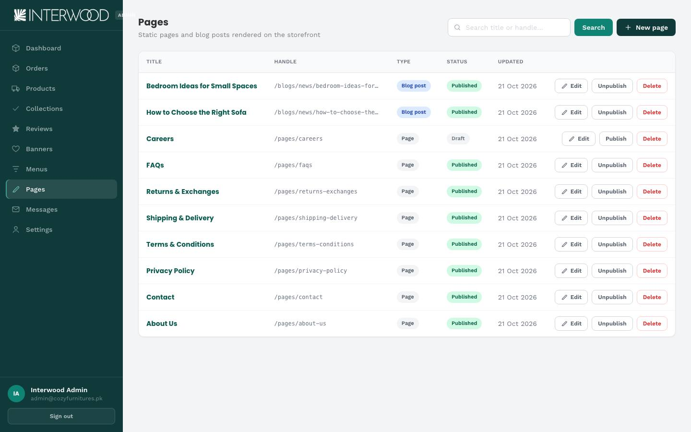
   <sub>Screenshot 23: Pages list</sub>


## 8. Shopping as a customer

Use a **different browser or a private window** for this part so you are not logged in as admin (the cart is stored in the browser).


### 8.1 Home page

1. Open `http://localhost:3000/`.

> ✅ **Expected:** From top to bottom:
   - announcement bar, header with the **main navigation** (Living Room ▾, Bedroom ▾, Office **NEW**, All Products, Sale **SALE** — no “Clearance”);
   - **hero slider** with 2 slides (the inactive “Coming Soon: Dining” is hidden);
   - **Office Upgrade** promo strip;
   - **Hot Selling Products**: only Alexa Sofa Chair, Antonin Sofa and Alpen King Size Bed (the hot ones);
   - **Shop by Category** tiles: Living Room, Sofas, Bedroom, Office Chairs (the featured collections);
   - rating banner **4.8 out of 5 (1,200+ happy customers)**, then the **Free Delivery Over Rs. 100,000** promo strip;
   - one product row per featured collection; the draft product never appears.


   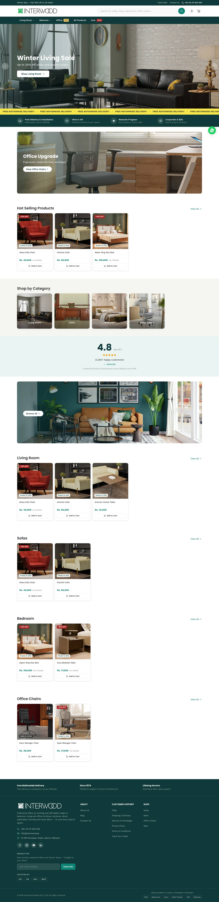
   <sub>Screenshot 24: Home page built entirely from the admin</sub>

2. In the hero, click the **›** arrow.

> ✅ **Expected:** The slide changes to **Sleep Like Royalty** (slides also auto-rotate every 5 seconds).


   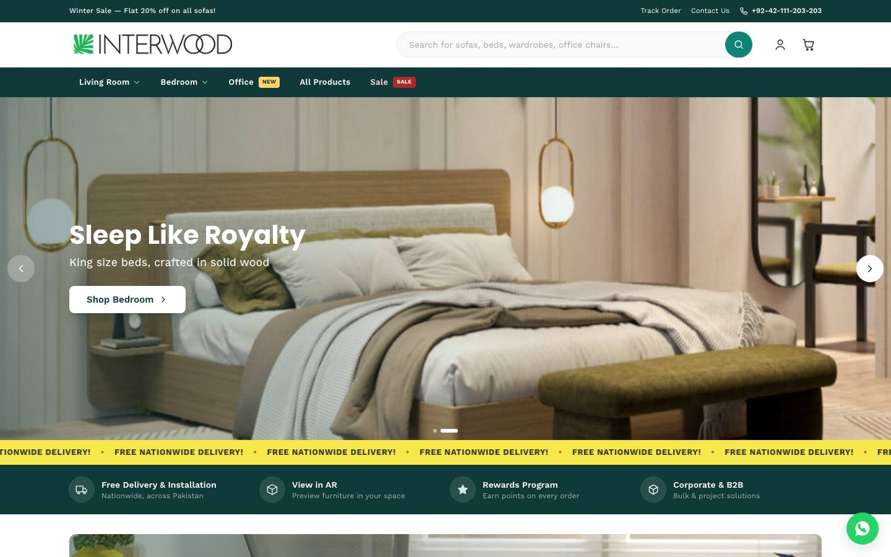
   <sub>Screenshot 25: Second hero slide</sub>


### 8.2 Navigation dropdown

1. Hover **Living Room** in the dark navigation bar.

> ✅ **Expected:** A dropdown shows **Sofas** and **Coffee Tables**.


   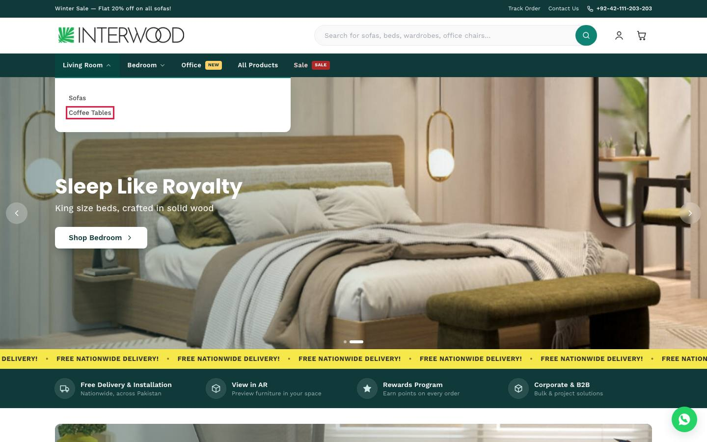
   <sub>Screenshot 26: Main navigation dropdown</sub>

2. Click **Sofas**.

> ✅ **Expected:** The **Sofas** collection: breadcrumb, title, description, a Filter & Sort bar and 2 products (Alexa Sofa Chair, Antonin Sofa). The Antonin card shows **Rs. 85,000** (cheapest size) with no discount badge, because the 2-Seater has no compare-at price.


   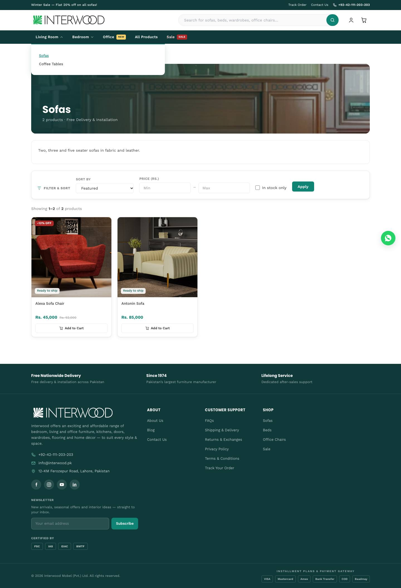
   <sub>Screenshot 27: Sofas collection page</sub>


### 8.3 Sort and filter

1. Click **All Products** in the navigation.
2. Open **Sort by** and choose **Price: Low to High**.

> ✅ **Expected:** 7 products (not the draft), cheapest first: Aura Bedside Table (Rs. 17,500), Antonin Center Table (Rs. 32,000), Apex Manager Chair (Rs. 37,000)… Alpen King Size Bed (Rs. 150,000) last. Aeon Manager Chair carries a **Made to Order** badge.


   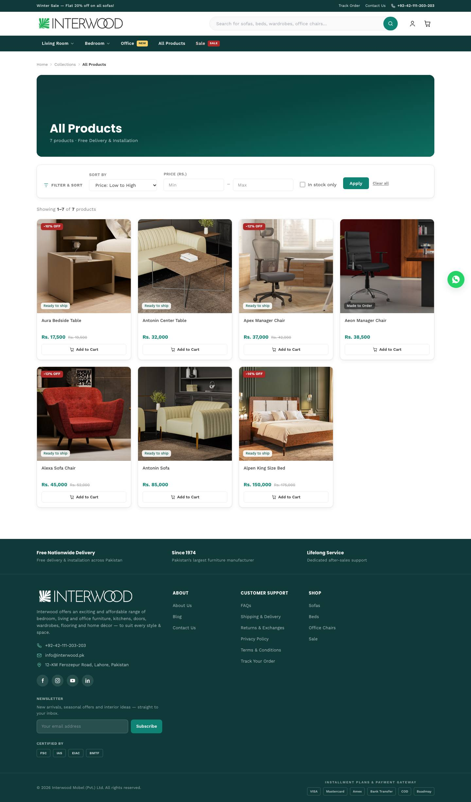
   <sub>Screenshot 28: All products sorted by price</sub>

3. In the filter bar, enter a price range:

   | Field | Value |
   |---|---|
   | Price — Min | `30000` |
   | Price — Max | `50000` |

4. Click **Apply**.

> ✅ **Expected:** Only products with a price between Rs. 30,000 and Rs. 50,000: Alexa Sofa Chair, Antonin Center Table, Aeon Manager Chair, Apex Manager Chair.


   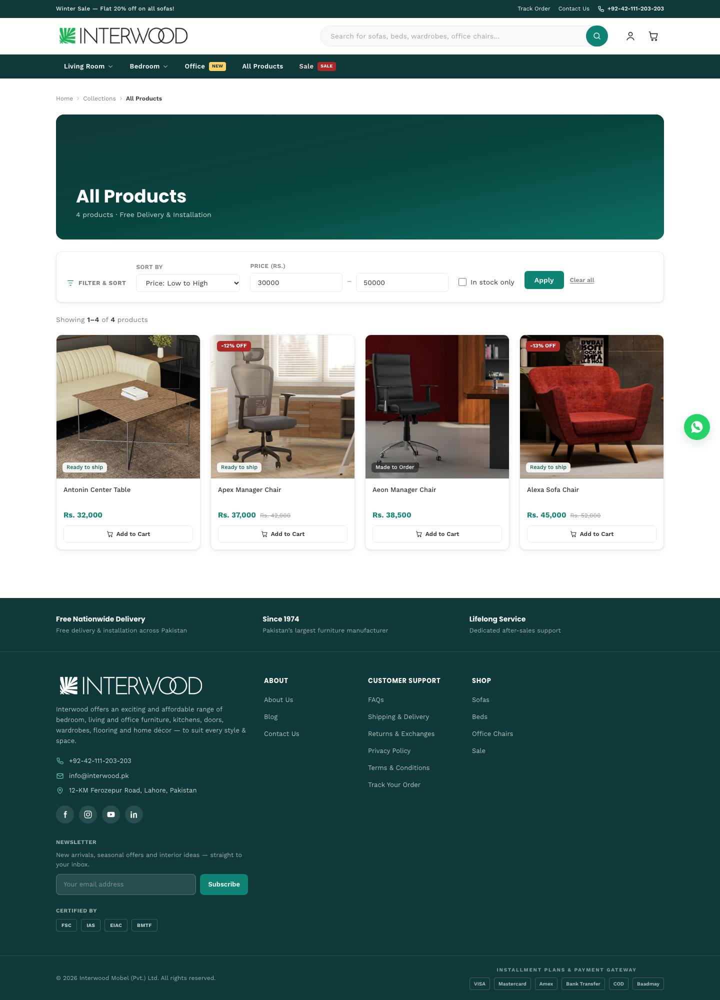
   <sub>Screenshot 29: Price filter applied</sub>


### 8.4 Search

1. Type in the header search box:

   | Field | Value |
   |---|---|
   | Search box (header) | `chair` |

2. Press **Enter**.

> ✅ **Expected:** Results for “chair”: Alexa Sofa Chair, Aeon Manager Chair, Apex Manager Chair.


   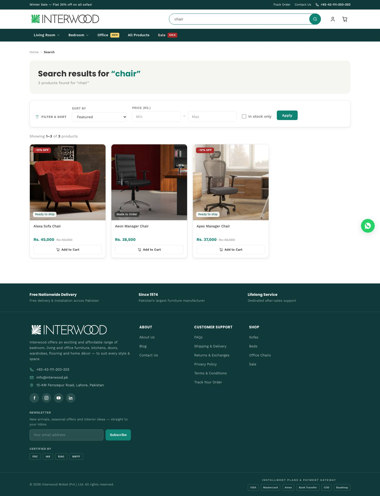
   <sub>Screenshot 30: Search results for chair</sub>


### 8.5 Product page

1. Open the **Antonin Sofa** (click it in any listing).

> ✅ **Expected:** Gallery with 3 images and thumbnails; title, “No reviews yet” link, price **Rs. 120,000** with **Rs. 140,000** struck through and **-14% OFF**; SKU **ANT-3**, **In Stock — Only 5 left**; Size buttons; quantity; **Add to Cart** / **Buy Now**; Description / Delivery & Returns / Warranty accordions; Customer Reviews; “You May Also Like”. The browser tab reads “Antonin Sofa | Interwood”.


   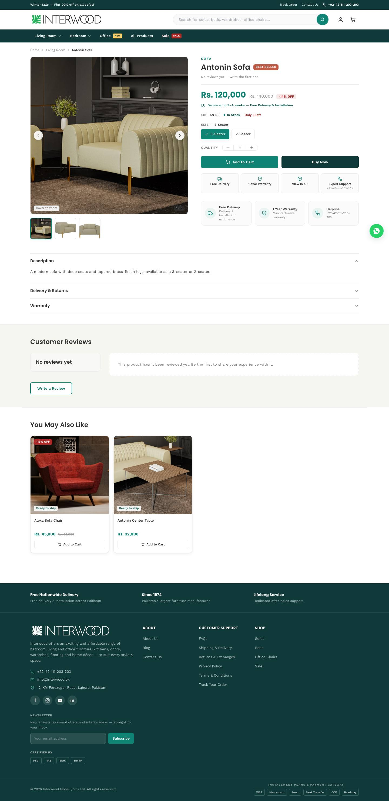
   <sub>Screenshot 31: Antonin Sofa product page</sub>

2. Click the **2-Seater** size button.

> ✅ **Expected:** Price changes to **Rs. 85,000** with no discount, SKU **ANT-2**, “Only 8 left”.


   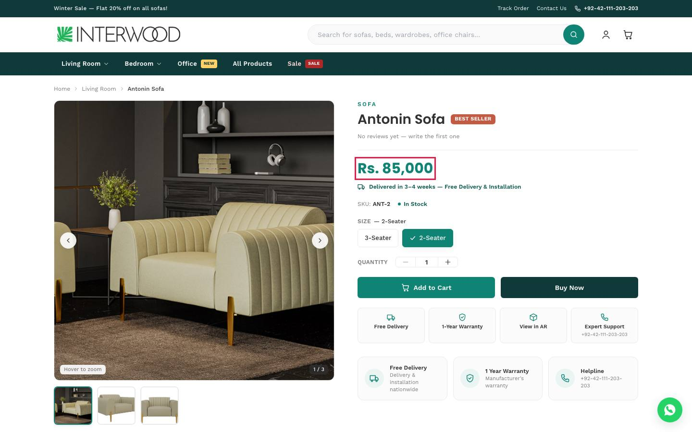
   <sub>Screenshot 32: Variant switched to 2-Seater</sub>

3. Click the second thumbnail under the main image.

> ✅ **Expected:** The main image switches (hover the main image on desktop to zoom).

4. Open **Aeon Manager Chair**.

> ✅ **Expected:** Stock shows **Made to Order** (inventory 0) and it can still be added to the cart.


   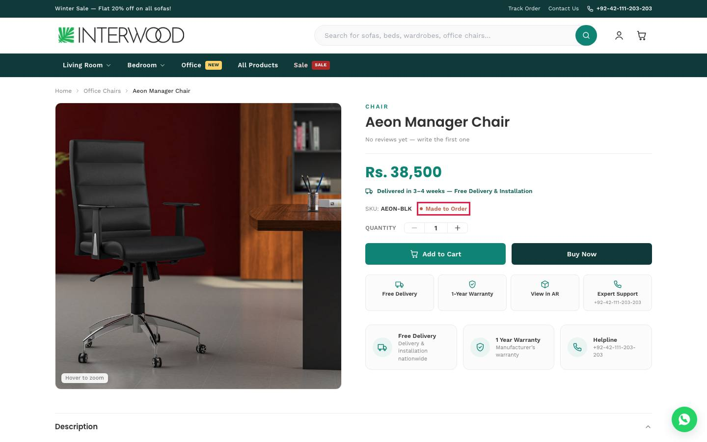
   <sub>Screenshot 33: Made to Order product</sub>


### 8.6 Cart

1. Open **Alexa Sofa Chair**.
2. Click **+** once (quantity 2).
3. Click **Add to Cart**.

> ✅ **Expected:** The cart icon in the header shows **2**.


   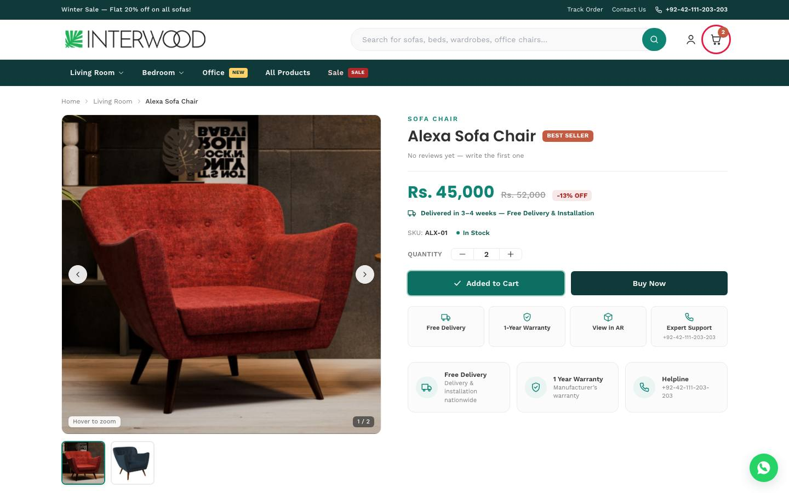
   <sub>Screenshot 34: Cart badge after adding to cart</sub>

4. Open **Antonin Sofa**.
5. Choose **2-Seater**.
6. Click **Add to Cart**.
7. Open **Bedroom ▸ Bedside Tables**.
8. On the **Aura Bedside Table** card, click **Add to Cart** (quick add, without opening the product).
9. Click the **cart icon** in the header.

> ✅ **Expected:** 3 lines: Alexa Sofa Chair ×2 (Rs. 90,000), Antonin Sofa **2-Seater** ×1 (Rs. 85,000), Aura Bedside Table ×1 (Rs. 17,500). Subtotal **Rs. 192,500**, “You save” shows the discount, **Delivery & Installation: FREE** (over Rs. 100,000).


   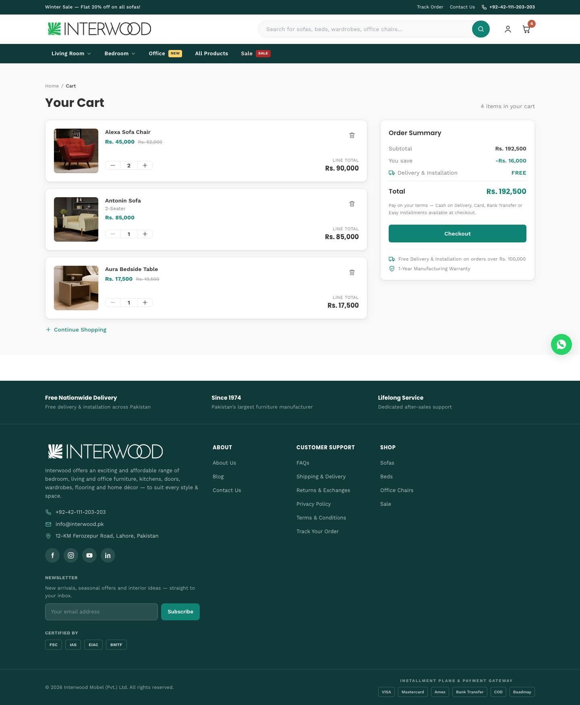
   <sub>Screenshot 35: Cart with three products</sub>

10. Click the trash icon on **Aura Bedside Table**.

> ✅ **Expected:** The line disappears and the subtotal becomes **Rs. 175,000**. (The − / + buttons change quantities the same way.)


### 8.7 Checkout — validation

1. Click **Checkout**.
2. Without filling anything, click **Place Order (Cash on Delivery)**.

> ✅ **Expected:** Nothing is submitted. Required fields turn red with messages, and the summary shows “Please correct the highlighted fields below.”


   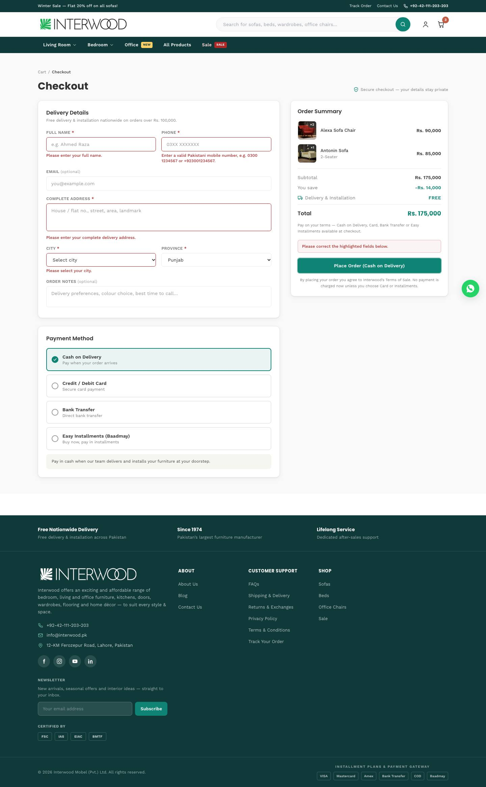
   <sub>Screenshot 36: Checkout validation errors</sub>

3. Type an invalid phone:

   | Field | Value |
   |---|---|
   | Phone | `12345` |

4. Click **Place Order** again.

> ✅ **Expected:** “Enter a valid Pakistani mobile number, e.g. 0300 1234567 or +923001234567.”


### 8.8 Order 1 — cash on delivery, free delivery

1. Fill in the form exactly as follows:

   | Field | Value |
   |---|---|
   | Full Name | `Ayesha Khan` |
   | Phone | `0300 1234567` |
   | Email (optional) | `ayesha@example.com` |
   | Complete Address | `House 12, Street 4, DHA Phase 5` |
   | City | `Lahore` |
   | Province | `Punjab` |
   | Order Notes (optional) | `Please call before delivery.` |

2. Leave the payment method on **Cash on Delivery**.

> ✅ **Expected:** Order Summary: Alexa Sofa Chair ×2, Antonin Sofa 2-Seater ×1, Subtotal Rs. 175,000, Delivery & Installation **FREE**, Total **Rs. 175,000**.


   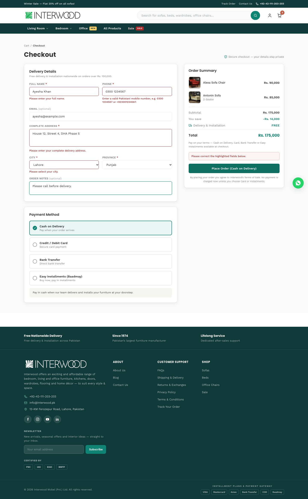
   <sub>Screenshot 37: Checkout filled in, free delivery</sub>

3. Click **Place Order (Cash on Delivery)**.

> ✅ **Expected:** The **Thank You!** page with order number **IW-100001** and the next steps. The cart icon is empty again.


   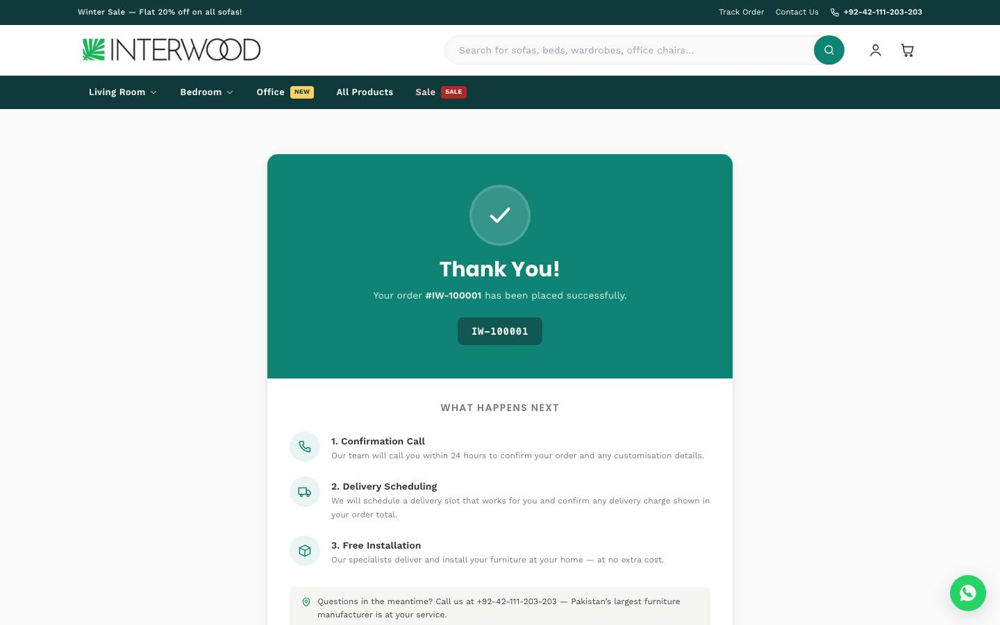
   <sub>Screenshot 38: Order confirmation page</sub>


### 8.9 Order 2 — bank transfer, below the free-delivery threshold

1. Open **Apex Manager Chair**.
2. Choose **Without Headrest** (Rs. 37,000).
3. Click **Add to Cart**.
4. Open the cart and click **Checkout**.

> ✅ **Expected:** Subtotal Rs. 37,000, Delivery & Installation **Rs. 2,500**, Total **Rs. 39,500**, and the hint “Add Rs. 63,000 more for free delivery & installation.”


   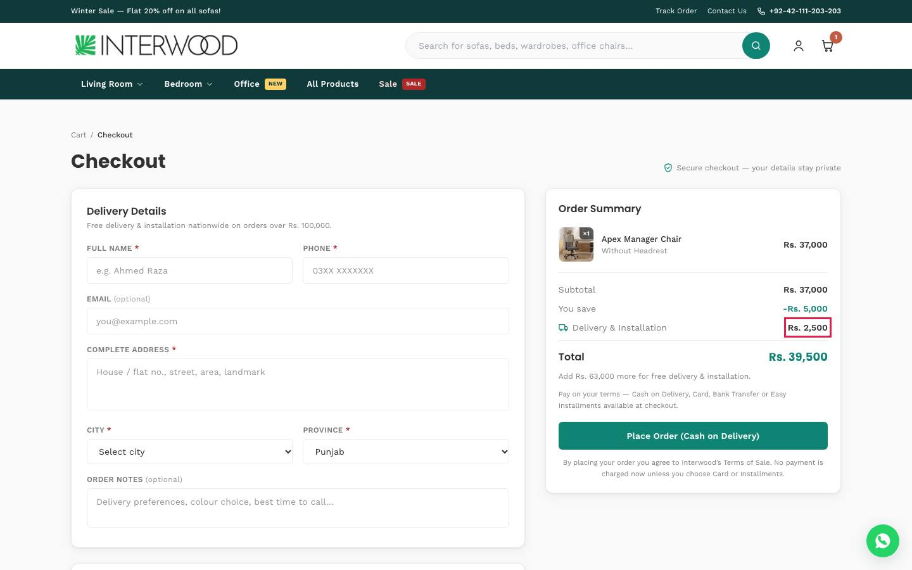
   <sub>Screenshot 39: Delivery fee applied below the threshold</sub>

5. Fill in the form exactly as follows:

   | Field | Value |
   |---|---|
   | Full Name | `Bilal Ahmed` |
   | Phone | `03211234567` |
   | Email (optional) | _(leave empty)_ |
   | Complete Address | `Flat 3, Block B, Gulshan-e-Iqbal` |
   | City | `Karachi` |
   | Province | `Sindh` |

6. Under payment, choose **Bank Transfer**.
7. Click **Place Order**.

> ✅ **Expected:** Confirmation page for order **IW-100002**.


### 8.10 Track an order

1. Click **Track Order** in the top bar.
2. Try a **wrong phone number** first:

   | Field | Value |
   |---|---|
   | Order Number | `IW-100001` |
   | Phone Number | `03009999999` |

3. Click **Track Order**.

> ✅ **Expected:** “No order found for these details. Please check your order number and phone number.” — an order is only shown when the number and phone match.

4. Correct the phone:

   | Field | Value |
   |---|---|
   | Phone Number | `0300 1234567` |

5. Click **Track Order**.

> ✅ **Expected:** The order with a status timeline at **Order Placed** (Order Confirmed → In Production → Shipped → Delivered & Installed are still ahead).


   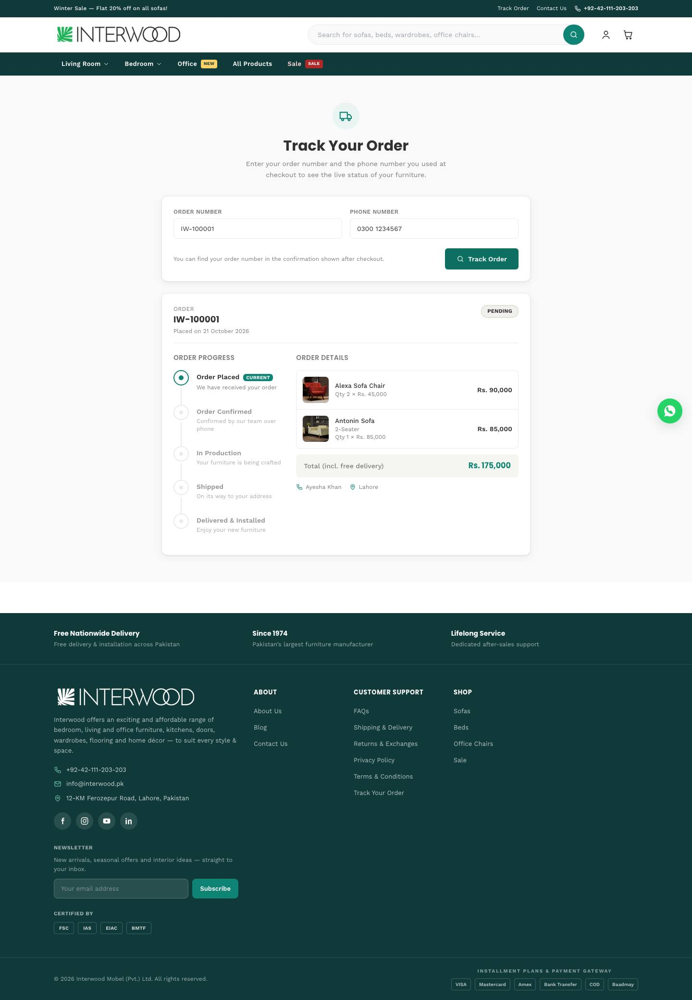
   <sub>Screenshot 40: Order tracking — order placed</sub>


### 8.11 Contact form and newsletter

1. Click **Contact Us** in the top bar.
2. Below the page text, fill in **Send Us a Message**:

   | Field | Value |
   |---|---|
   | Full Name | `Hamza Ali` |
   | Email Address | `hamza@example.com` |
   | Phone Number | `03331234567` |
   | Subject | `Sales` |
   | Message | `Do you make wardrobes in custom sizes? I need a 7ft one.` |


   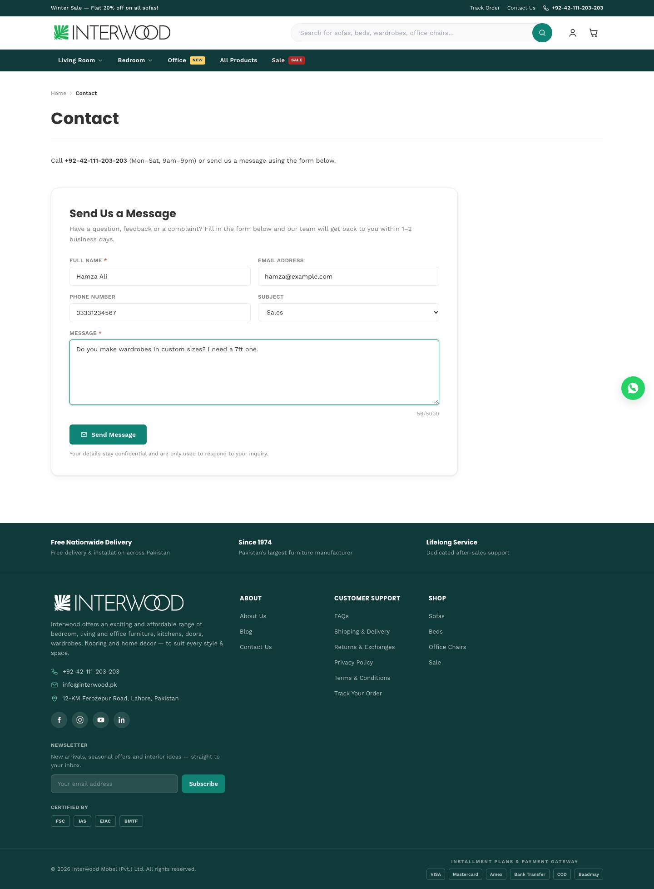
   <sub>Screenshot 41: Contact page with the form filled in</sub>

3. Click **Send Message**.

> ✅ **Expected:** “Thank you, your message is on its way!”

4. Scroll to the footer newsletter box:

   | Field | Value |
   |---|---|
   | Newsletter — Your email address (footer) | `sara@example.com` |

5. Click **Subscribe**.

> ✅ **Expected:** “Subscribed!” — the sign-up arrives in the admin **Messages** inbox.


### 8.12 Write a product review

1. Open **Alexa Sofa Chair** and scroll to **Customer Reviews**.
2. Click **Write a Review**.
3. Click the **4th star**.
4. Fill in the form exactly as follows:

   | Field | Value |
   |---|---|
   | Your name | `Sana Malik` |
   | Title | `Comfy and well made` |
   | Your review | `Very comfortable chair, the velvet feels premium and delivery was quick.` |


   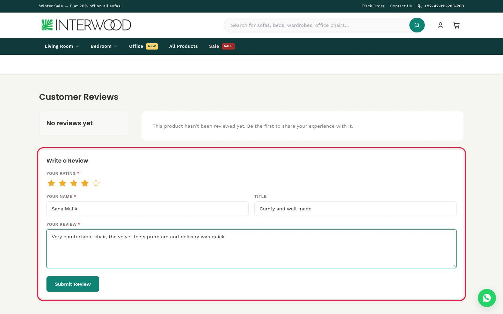
   <sub>Screenshot 42: Review form filled in</sub>

5. Click **Submit Review**.

> ✅ **Expected:** “Thank you! Your review has been submitted and will appear once it’s approved.” Reload — the review is **not** shown yet.


### 8.13 Content pages, blog and 404

1. In the footer (Customer Support), click **Privacy Policy**.

> ✅ **Expected:** `/pages/privacy-policy` with breadcrumb, title and formatted headings. The same works for FAQs, Shipping & Delivery, Returns & Exchanges, Terms & Conditions and About Us.


   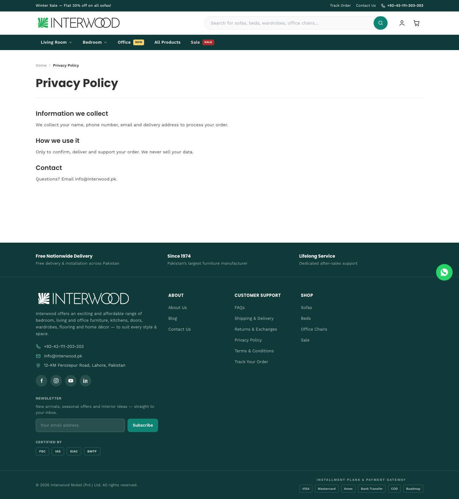
   <sub>Screenshot 43: Privacy Policy page</sub>

2. Open the unpublished page: `http://localhost:3000/pages/careers`.

> ✅ **Expected:** The **404 – Page not found** page with a search box and helpful links.


   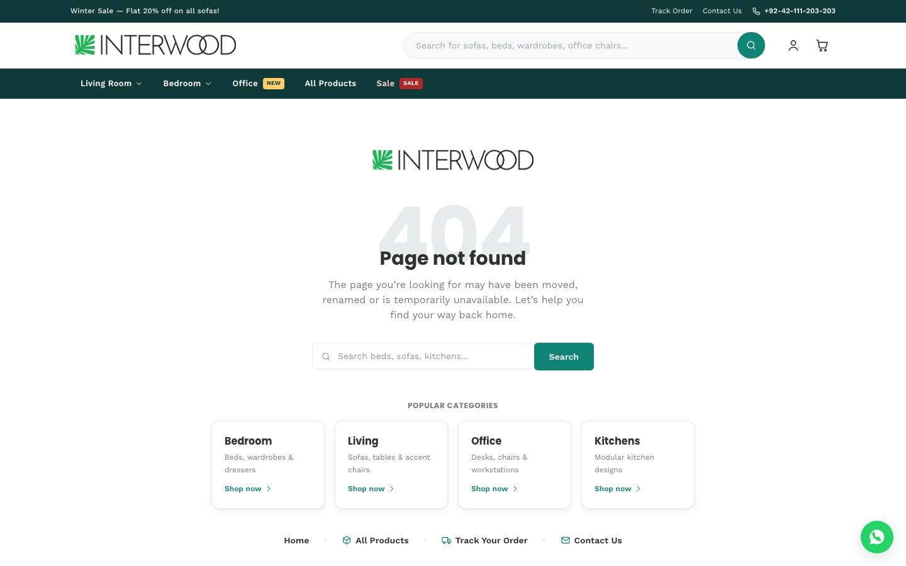
   <sub>Screenshot 44: 404 page for an unpublished page</sub>

3. In the footer (About), click **Blog**.

> ✅ **Expected:** **News & Stories** listing both posts, newest first.


   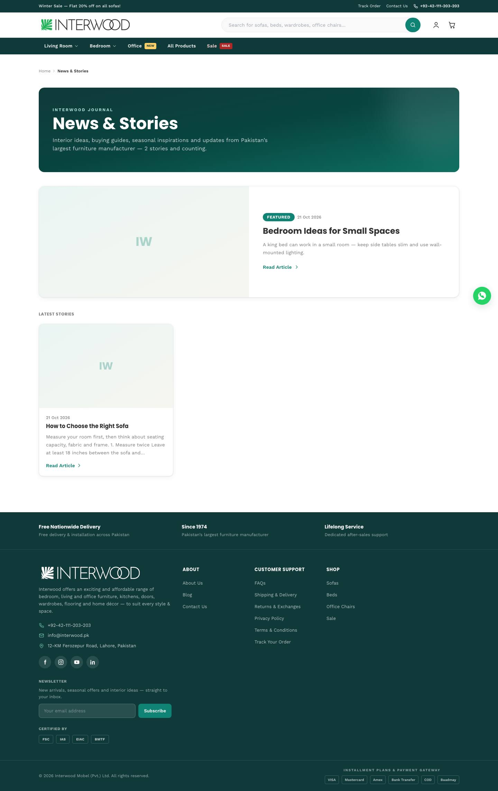
   <sub>Screenshot 45: Blog listing</sub>

4. Click **How to Choose the Right Sofa**.

> ✅ **Expected:** The full article at `/blogs/news/how-to-choose-the-right-sofa`.


   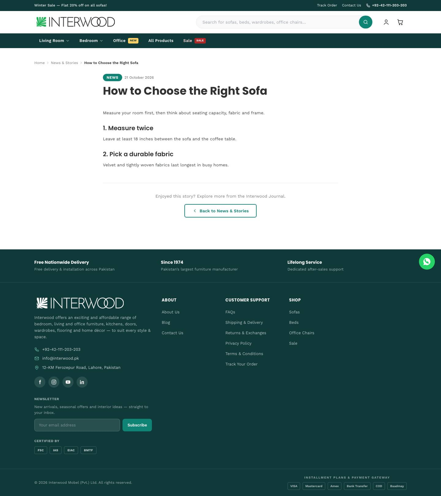
   <sub>Screenshot 46: Blog post</sub>


## 9. Running the store as the admin

Back in the admin tab.


### 9.1 Dashboard

1. In the left sidebar, click **Dashboard**.

> ✅ **Expected:** Total Orders **2**, Revenue **Rs. 214,500** (175,000 + 39,500), Products 7 active, Pending Orders **2**, New Messages **2**, and both orders under Recent Orders. The sidebar shows badges next to Orders and Messages.


   
   <sub>Screenshot 47: Dashboard with orders and messages</sub>


### 9.2 Process order 1 through to delivery

1. In the left sidebar, click **Orders**.

   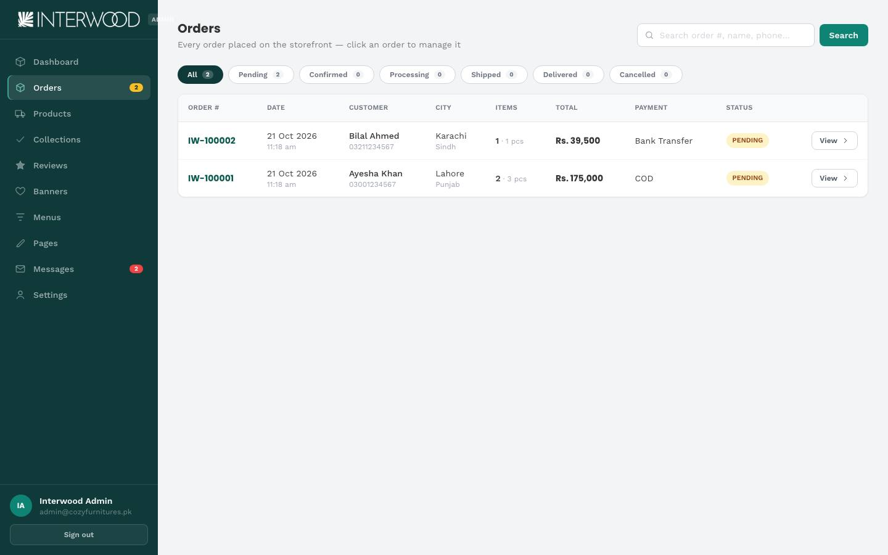
   <sub>Screenshot 48: Orders list</sub>

2. Click order **IW-100001** (Ayesha Khan).

> ✅ **Expected:** Items with quantities and line totals, customer details with call/email links, address, the customer’s note, payment method and totals.


   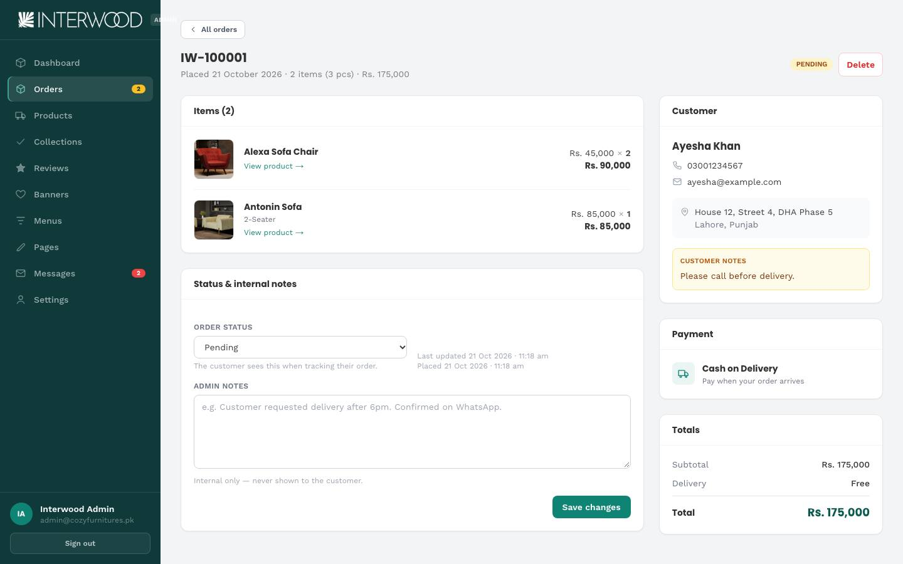
   <sub>Screenshot 49: Order detail</sub>

3. Set the status to **Confirmed**:

   | Field | Value |
   |---|---|
   | Order status | `Confirmed` |
   | Admin notes | `Confirmed on phone with Ayesha.` |

4. Click **Save changes**.
5. Set the status to **Shipped**:

   | Field | Value |
   |---|---|
   | Order status | `Shipped` |
   | Admin notes | `Dispatched with TCS.` |

6. Click **Save changes**.

> ✅ **Expected:** After each save the status badge updates and a timestamped line such as `[2026-…] status CONFIRMED → SHIPPED` is appended to the internal notes.


   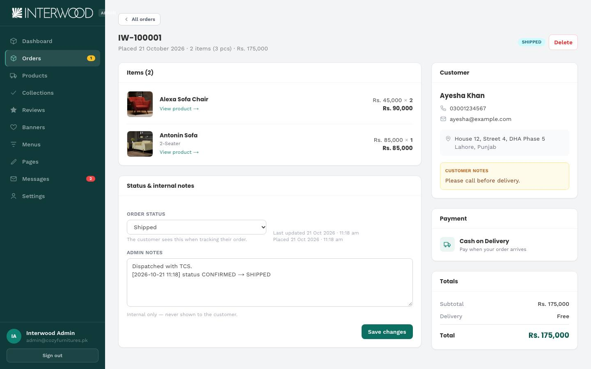
   <sub>Screenshot 50: Order marked as shipped</sub>

7. In the shopper tab, track order 1 again (same number and phone).

> ✅ **Expected:** The timeline has advanced to **Shipped**. Admin notes are never shown to the customer.


   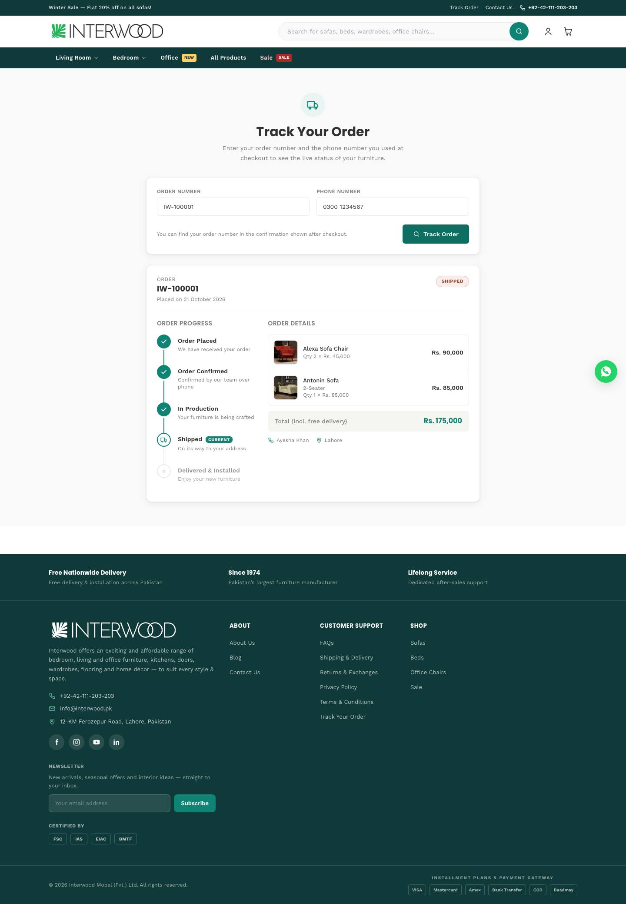
   <sub>Screenshot 51: Customer sees the order as shipped</sub>

8. Back in the admin, finish the order:

   | Field | Value |
   |---|---|
   | Order status | `Delivered` |

9. Click **Save changes**.

### 9.3 Cancel order 2

1. In the left sidebar, click **Orders**.
2. Open order **IW-100002** (Bilal Ahmed).

> ✅ **Expected:** Delivery **Rs. 2,500** and Total **Rs. 39,500** — exactly what checkout showed.

3. Fill in the form exactly as follows:

   | Field | Value |
   |---|---|
   | Order status | `Cancelled` |
   | Admin notes | `Customer cancelled by phone.` |

4. Click **Save changes**.
5. In the left sidebar, click **Orders**.

> ✅ **Expected:** The list shows one **DELIVERED** and one **CANCELLED** order. Use the status pills above the table to filter.


   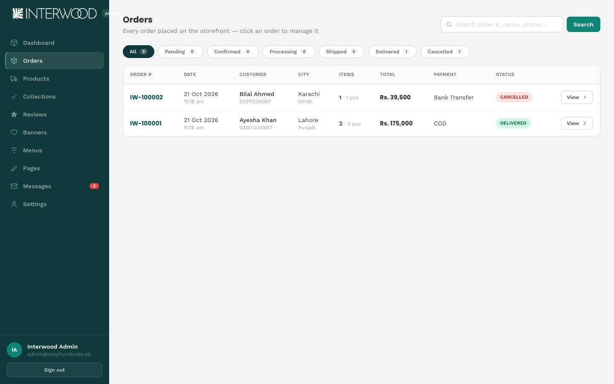
   <sub>Screenshot 52: Orders after processing</sub>


### 9.4 Messages inbox

1. In the left sidebar, click **Messages**.

> ✅ **Expected:** Two **NEW** messages: Hamza Ali (Sales) and the newsletter sign-up.

2. On **Hamza Ali**, click **View**.

> ✅ **Expected:** The full message with **Mark as Read**, **Mark as Closed**, **Delete** and **Reply by email →**.


   
   <sub>Screenshot 53: Message opened</sub>

3. Click **Mark as Read**.
4. Click **Mark as Closed**.

> ✅ **Expected:** The status pills update: **New 1**, **Closed 1**.


### 9.5 Approve the review

1. In the left sidebar, click **Reviews**.

> ✅ **Expected:** Sana Malik’s 4-star review with an amber **Pending** status.


   
   <sub>Screenshot 54: Pending review</sub>

2. Click **Pending** to approve it.

> ✅ **Expected:** The status turns green **Approved** (click again to unapprove).

3. In the shopper tab, open **Alexa Sofa Chair** again.

> ✅ **Expected:** Stars **(1)** under the title; Customer Reviews shows **4.0 — Based on 1 review** and the review itself.


   
   <sub>Screenshot 55: Approved review on the product page</sub>


### 9.6 Hide a product, then delete the draft

1. In the left sidebar, click **Products**.
2. Edit **Antonin Center Table**.
3. Fill in the form exactly as follows:

   | Field | Value |
   |---|---|
   | Status | `Draft` |

4. Click **Save product**.

> ✅ **Expected:** In the shopper tab, `/products/antonin-center-table` is now a 404 and the product is gone from listings. Set it back to **Active** and save to restore it.

5. Click **Save product**.
6. In the left sidebar, click **Products**.
7. On **Prototype Dining Table**, click the trash icon and confirm the browser dialog.

> ✅ **Expected:** The product is deleted: **7 products in the catalog**.


### 9.7 Rename a collection, disable a menu link, deactivate a banner, unpublish a page

1. In the left sidebar, click **Collections**.
2. Edit **Office Chairs**.
3. Fill in the form exactly as follows:

   | Field | Value |
   |---|---|
   | Title | `Office Seating` |

4. Click **Save collection**.

> ✅ **Expected:** `/collections/office-chairs` now shows the title **Office Seating** (the URL handle stays the same).

5. In the left sidebar, click **Menus**.
6. In **Main navigation**, click the **All Products** row to expand it.
7. Fill in the form exactly as follows:

   | Field | Value |
   |---|---|
   | Enabled (visible) | `☐ unchecked` |

8. Click **Save item**.

> ✅ **Expected:** **All Products** disappears from the storefront navigation.

9. In the left sidebar, click **Banners**.
10. Click **Deactivate** on **Sleep Like Royalty**.

> ✅ **Expected:** The hero slider now has a single slide.

11. In the left sidebar, click **Pages**.
12. On **About Us**, click **Unpublish**.

> ✅ **Expected:** `/pages/about-us` returns 404 until you click **Publish** again.

13. Click **Publish** to bring it back.

   
   <sub>Screenshot 56: Pages list after publishing again</sub>


### 9.8 Change a setting

1. In the left sidebar, click **Settings**.
2. Fill in the form exactly as follows:

   | Field | Value |
   |---|---|
   | Announcement Bar (top of every page) | `Free delivery on orders over Rs. 100,000!` |

3. Click **Save Settings**.

> ✅ **Expected:** The storefront announcement bar changes immediately.


   
   <sub>Screenshot 57: Final storefront home page</sub>


### 9.9 Sign out

1. Click **Sign out** (bottom of the sidebar).

> ✅ **Expected:** Back on the login page; opening any /admin URL redirects to login again.


## 10. On a phone

Open the storefront on a phone, or use your browser’s device toolbar (e.g. Chrome DevTools → iPhone 13).

1. Open the home page.

> ✅ **Expected:** Portrait hero (mobile image), stacked sections, and a hamburger menu instead of the navigation bar. No sideways scrolling.


   
   <sub>Screenshot 58: Mobile home page</sub>

2. Tap the **☰** menu.
3. Tap the arrow next to **Living Room**.

> ✅ **Expected:** The drawer lists the main navigation (Living Room expanded to Sofas / Coffee Tables), then the **Top bar** links (Track Order, Contact Us) and a tap-to-call phone button.


   
   <sub>Screenshot 59: Mobile menu drawer</sub>

4. Tap **Sofas**.

   
   <sub>Screenshot 60: Mobile collection page</sub>

5. Tap **Antonin Sofa**.

   
   <sub>Screenshot 61: Mobile product page</sub>

## Appendix A — How the pieces fit together

| Admin setting | Where it shows on the storefront |
|---|---|
| **Settings → Announcement Bar** | Dark strip at the very top of every page (empty = hidden) |
| **Settings → Phone / Emails / Address** | Top bar phone, footer contact block, product page "Expert Support" |
| **Settings → WhatsApp Number** | Green floating WhatsApp button |
| **Settings → Social links** | Footer icons (empty = icon hidden) |
| **Settings → Shipping Fee / Free Shipping Threshold** | Cart and checkout "Delivery & Installation" line, and the amount actually charged |
| **Settings → Overall Rating / Rating Count Label** | Home page rating banner |
| **Collection → Featured on homepage** | "Shop by Category" tile + its own product row on the home page (ordered by Position) |
| **Collection → Show in navigation** | Listed on `/collections` |
| **Product → Hot product** | "Hot Selling Products" row on the home page |
| **Product → Status Draft/Archived** | Hidden everywhere on the storefront (404 on its URL) |
| **Variant → Inventory 0** | "Made to Order" (still purchasable) |
| **Variant → Compare at** | Struck-through price and "-X% OFF" badge |
| **Banner → Location** | Hero slider (top), Promo strip 1 (under the trust strip), Promo strip 2 (under the rating banner) |
| **Menus** | Main navigation (with dropdowns), top bar links, three footer columns |
| **Page with handle `contact`** | Gets the contact form automatically |
| **Page → Blog post** | Listed on `/blogs`, served at `/blogs/news/<handle>` |
| **Order → Status** | Customer's tracking timeline on `/track` (admin notes are never shown) |
| **Review → Approved** | Shown on the product page and in its star rating |
| Contact form & newsletter | Arrive in **Messages** |

## Appendix B — Order status flow

`Pending` (Order Placed) → `Confirmed` (Order Confirmed) → `Processing` (In Production) → `Shipped` → `Delivered` (Delivered & Installed). `Cancelled` can be set at any point and is excluded from dashboard revenue.

## Appendix C — Known limitations

- **No customer accounts.** The person icon in the header opens a login page, but it is only a placeholder; customers track orders with order number + phone instead.
- **First admin user** must be created with `npm run db:admin`; there is no admin sign-up or user management screen.
- **No image upload**: images are paths under `public/images/` or external URLs.
- **Card / Installments** are recorded as the chosen payment method only; no payment gateway is connected.
- **Newsletter** sign-ups are stored as messages in the inbox (no mailing-list integration).
- Product form errors detected **only by the server** (e.g. invalid Options JSON) reload the form and clear unsaved changes; price/stock mistakes are caught in the browser first.

## Regenerating this guide

```bash
rm -f prisma/dev.db && npm run db:push && npm run db:admin
npm run build && npx next start -p 3100     # the generator expects port 3100
npm run docs:walkthrough                    # rewrites docs/walkthrough/README.md + screenshots/
```

The automated regression suite (44 tests, same "browser only" rules) runs with `npm run test:e2e` against the same kind of fresh database.
